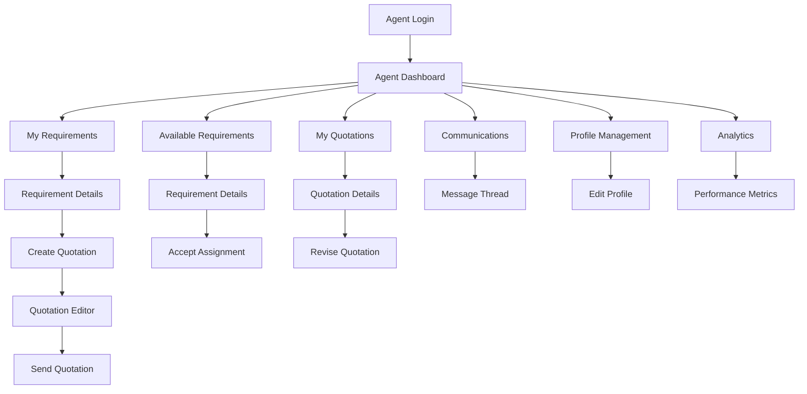

# UI/UX Design for Agent Dashboard and Management Flow

## Overview
This document outlines the user interface and experience design for the travel agent dashboard and management system.

## Agent Journey Flow



## Page Structure and Components

### 1. Agent Dashboard

**Route:** `/app/(pages)/agent/dashboard/page.js`

**Component:** `components/pages/agent/Dashboard.jsx`

```jsx
const AgentDashboard = () => {
  const [agentProfile, setAgentProfile] = useState(null);
  const [dashboardData, setDashboardData] = useState({
    stats: {},
    recentRequirements: [],
    upcomingDeadlines: [],
    notifications: []
  });
  const [isLoading, setIsLoading] = useState(true);

  return (
    <div className="agent-dashboard">
      <div className="dashboard-header">
        <h1>Welcome back, {agentProfile?.firstName}!</h1>
        <p className="dashboard-date">{new Date().toLocaleDateString('en-US', { 
          weekday: 'long', 
          year: 'numeric', 
          month: 'long', 
          day: 'numeric' 
        })}</p>
      </div>
      
      {/* Quick Stats */}
      <div className="stats-grid">
        <div className="stat-card">
          <div className="stat-icon">📋</div>
          <div className="stat-content">
            <h3>Active Requirements</h3>
            <p className="stat-number">{dashboardData.stats.activeRequirements}</p>
            <span className="stat-change positive">
              +{dashboardData.stats.weeklyChange}% from last week
            </span>
          </div>
        </div>
        
        <div className="stat-card">
          <div className="stat-icon">💬</div>
          <div className="stat-content">
            <h3>Pending Messages</h3>
            <p className="stat-number">{dashboardData.stats.pendingMessages}</p>
            <span className="stat-change">New messages</span>
          </div>
        </div>
        
        <div className="stat-card">
          <div className="stat-icon">📄</div>
          <div className="stat-content">
            <h3>Quotations Sent</h3>
            <p className="stat-number">{dashboardData.stats.quotationsSent}</p>
            <span className="stat-change positive">
              {dashboardData.stats.conversionRate}% conversion rate
            </span>
          </div>
        </div>
        
        <div className="stat-card">
          <div className="stat-icon">⭐</div>
          <div className="stat-content">
            <h3>Customer Rating</h3>
            <p className="stat-number">{dashboardData.stats.averageRating}/5</p>
            <span className="stat-change positive">
              +{dashboardData.stats.ratingChange} this month
            </span>
          </div>
        </div>
      </div>
      
      <div className="dashboard-content">
        {/* Recent Requirements */}
        <div className="content-section">
          <div className="section-header">
            <h2>Recent Requirements</h2>
            <button className="btn-link" onClick={() => router.push('/agent/requirements')}>
              View All
            </button>
          </div>
          <div className="requirements-list">
            {dashboardData.recentRequirements.map(requirement => (
              <RequirementCard 
                key={requirement._id} 
                requirement={requirement}
                compact={true}
              />
            ))}
          </div>
        </div>
        
        {/* Upcoming Deadlines */}
        <div className="content-section">
          <div className="section-header">
            <h2>Upcoming Deadlines</h2>
            <button className="btn-link" onClick={() => router.push('/agent/calendar')}>
              View Calendar
            </button>
          </div>
          <div className="deadlines-list">
            {dashboardData.upcomingDeadlines.map(deadline => (
              <div key={deadline._id} className="deadline-item">
                <div className="deadline-date">
                  <span className="day">{new Date(deadline.date).getDate()}</span>
                  <span className="month">{new Date(deadline.date).toLocaleDateString('en-US', { month: 'short' })}</span>
                </div>
                <div className="deadline-content">
                  <h4>{deadline.title}</h4>
                  <p>{deadline.requirementTitle}</p>
                </div>
                <div className={`deadline-priority ${deadline.priority}`}>
                  {deadline.priority}
                </div>
              </div>
            ))}
          </div>
        </div>
      </div>
      
      {/* Notifications Panel */}
      <div className="notifications-panel">
        <h3>Notifications</h3>
        <div className="notifications-list">
          {dashboardData.notifications.map(notification => (
            <div key={notification._id} className={`notification-item ${notification.type}`}>
              <div className="notification-icon">
                {getNotificationIcon(notification.type)}
              </div>
              <div className="notification-content">
                <p>{notification.message}</p>
                <span className="notification-time">
                  {formatTimeAgo(notification.createdAt)}
                </span>
              </div>
              <button 
                className="notification-close"
                onClick={() => dismissNotification(notification._id)}
              >
                ×
              </button>
            </div>
          ))}
        </div>
      </div>
    </div>
  );
};

// Requirement Card Component
const RequirementCard = ({ requirement, compact = false }) => {
  const priorityColors = {
    low: 'green',
    medium: 'blue',
    high: 'orange',
    urgent: 'red'
  };

  return (
    <div className={`requirement-card ${compact ? 'compact' : ''}`}>
      <div className="requirement-header">
        <h3>{requirement.title}</h3>
        <span className={`priority-badge ${priorityColors[requirement.priority]}`}>
          {requirement.priority}
        </span>
      </div>
      
      <div className="requirement-meta">
        <span className="category">{requirement.category}</span>
        <span className="destination">
          {requirement.travelDetails?.destinations?.[0]?.city}
        </span>
        <span className="date">
          {new Date(requirement.travelDetails?.departureDate).toLocaleDateString()}
        </span>
      </div>
      
      <p className="requirement-description">
        {requirement.description.substring(0, 100)}...
      </p>
      
      <div className="requirement-footer">
        <div className="budget-info">
          {requirement.travelDetails?.budget?.max && (
            <span>Budget: {requirement.travelDetails.budget.currency} {requirement.travelDetails.budget.max}</span>
          )}
        </div>
        <div className="requirement-actions">
          <button 
            className="btn-primary"
            onClick={() => router.push(`/agent/requirements/${requirement._id}`)}
          >
            View Details
          </button>
        </div>
      </div>
    </div>
  );
};
```

### 2. Requirements Management

**Route:** `/app/(pages)/agent/requirements/page.js`

**Component:** `components/pages/agent/RequirementsManagement.jsx`

```jsx
const RequirementsManagement = () => {
  const [activeTab, setActiveTab] = useState('assigned');
  const [requirements, setRequirements] = useState([]);
  const [filters, setFilters] = useState({
    status: '',
    category: '',
    priority: '',
    destination: '',
    dateRange: ''
  });
  const [searchQuery, setSearchQuery] = useState('');
  const [sortBy, setSortBy] = useState('createdAt');
  const [sortOrder, setSortOrder] = useState('desc');

  const tabs = [
    { id: 'assigned', label: 'Assigned to Me', count: 0 },
    { id: 'available', label: 'Available', count: 0 },
    { id: 'all', label: 'All Requirements', count: 0 }
  ];

  return (
    <div className="requirements-management">
      <div className="page-header">
        <h1>Requirements Management</h1>
        <div className="header-actions">
          <div className="search-box">
            <input
              type="text"
              placeholder="Search requirements..."
              value={searchQuery}
              onChange={(e) => setSearchQuery(e.target.value)}
            />
            <button className="search-icon">🔍</button>
          </div>
          <button className="btn-primary" onClick={() => setShowFilters(!showFilters)}>
            Filters {Object.values(filters).some(v => v) && '•'}
          </button>
        </div>
      </div>

      {/* Filters Panel */}
      {showFilters && (
        <div className="filters-panel">
          <div className="filter-group">
            <label>Status</label>
            <select
              value={filters.status}
              onChange={(e) => setFilters({...filters, status: e.target.value})}
            >
              <option value="">All Statuses</option>
              <option value="submitted">Submitted</option>
              <option value="assigned">Assigned</option>
              <option value="in_progress">In Progress</option>
              <option value="quotation_sent">Quotation Sent</option>
              <option value="quotation_accepted">Quotation Accepted</option>
              <option value="quotation_rejected">Quotation Rejected</option>
              <option value="completed">Completed</option>
            </select>
          </div>
          
          <div className="filter-group">
            <label>Category</label>
            <select
              value={filters.category}
              onChange={(e) => setFilters({...filters, category: e.target.value})}
            >
              <option value="">All Categories</option>
              <option value="flights">Flights</option>
              <option value="hotels">Hotels</option>
              <option value="packages">Packages</option>
              <option value="cruises">Cruises</option>
              <option value="car_rentals">Car Rentals</option>
              <option value="insurance">Insurance</option>
              <option value="visa">Visa</option>
            </select>
          </div>
          
          <div className="filter-group">
            <label>Priority</label>
            <select
              value={filters.priority}
              onChange={(e) => setFilters({...filters, priority: e.target.value})}
            >
              <option value="">All Priorities</option>
              <option value="low">Low</option>
              <option value="medium">Medium</option>
              <option value="high">High</option>
              <option value="urgent">Urgent</option>
            </select>
          </div>
          
          <div className="filter-group">
            <label>Destination</label>
            <input
              type="text"
              placeholder="Enter destination"
              value={filters.destination}
              onChange={(e) => setFilters({...filters, destination: e.target.value})}
            />
          </div>
          
          <div className="filter-group">
            <label>Departure Date</label>
            <input
              type="date"
              value={filters.dateRange}
              onChange={(e) => setFilters({...filters, dateRange: e.target.value})}
            />
          </div>
          
          <button className="btn-secondary" onClick={() => setFilters({
            status: '',
            category: '',
            priority: '',
            destination: '',
            dateRange: ''
          })}>
            Clear Filters
          </button>
        </div>
      )}

      {/* Tabs */}
      <div className="tabs-container">
        <div className="tabs">
          {tabs.map(tab => (
            <button
              key={tab.id}
              className={`tab ${activeTab === tab.id ? 'active' : ''}`}
              onClick={() => setActiveTab(tab.id)}
            >
              {tab.label}
              {tab.count > 0 && <span className="tab-count">{tab.count}</span>}
            </button>
          ))}
        </div>
        
        <div className="sort-controls">
          <label>Sort by:</label>
          <select
            value={sortBy}
            onChange={(e) => setSortBy(e.target.value)}
          >
            <option value="createdAt">Created Date</option>
            <option value="deadline">Deadline</option>
            <option value="priority">Priority</option>
            <option value="budget">Budget</option>
          </select>
          <button
            className="sort-order"
            onClick={() => setSortOrder(sortOrder === 'asc' ? 'desc' : 'asc')}
          >
            {sortOrder === 'asc' ? '↑' : '↓'}
          </button>
        </div>
      </div>

      {/* Requirements List */}
      <div className="requirements-list">
        {requirements.map(requirement => (
          <RequirementCard 
            key={requirement._id}
            requirement={requirement}
            onAccept={() => handleAcceptRequirement(requirement._id)}
            onDecline={() => handleDeclineRequirement(requirement._id)}
            showActions={activeTab === 'available'}
          />
        ))}
      </div>

      {/* Pagination */}
      <div className="pagination">
        <button 
          className="btn-secondary"
          disabled={currentPage === 1}
          onClick={() => setCurrentPage(currentPage - 1)}
        >
          Previous
        </button>
        <span className="page-info">
          Page {currentPage} of {totalPages}
        </span>
        <button 
          className="btn-secondary"
          disabled={currentPage === totalPages}
          onClick={() => setCurrentPage(currentPage + 1)}
        >
          Next
        </button>
      </div>
    </div>
  );
};
```

### 3. Requirement Details View

**Route:** `/app/(pages)/agent/requirements/[requirementId]/page.js`

**Component:** `components/pages/agent/RequirementDetails.jsx`

```jsx
const RequirementDetails = ({ requirementId }) => {
  const [requirement, setRequirement] = useState(null);
  const [activeTab, setActiveTab] = useState('details');
  const [communication, setCommunication] = useState(null);
  const [quotations, setQuotations] = useState([]);

  const tabs = [
    { id: 'details', label: 'Details' },
    { id: 'communication', label: 'Communication', badge: unreadCount },
    { id: 'quotations', label: 'Quotations' },
    { id: 'timeline', label: 'Timeline' }
  ];

  return (
    <div className="requirement-details">
      <div className="requirement-header">
        <div className="header-content">
          <div className="breadcrumb">
            <button onClick={() => router.push('/agent/requirements')}>
              Requirements
            </button>
            <span>/</span>
            <span>{requirement?.title}</span>
          </div>
          
          <div className="requirement-title-section">
            <h1>{requirement?.title}</h1>
            <div className="requirement-badges">
              <span className={`priority-badge priority-${requirement?.priority}`}>
                {requirement?.priority}
              </span>
              <span className="status-badge status-${requirement?.status}">
                {requirement?.status?.replace('_', ' ')}
              </span>
              <span className="category-badge">
                {requirement?.category}
              </span>
            </div>
          </div>
        </div>
        
        <div className="header-actions">
          {requirement?.status === 'submitted' && (
            <button 
              className="btn-primary"
              onClick={() => handleAcceptAssignment()}
            >
              Accept Assignment
            </button>
          )}
          {requirement?.status === 'assigned' && (
            <>
              <button 
                className="btn-primary"
                onClick={() => router.push(`/agent/quotations/create?requirement=${requirementId}`)}
              >
                Create Quotation
              </button>
              <button 
                className="btn-secondary"
                onClick={() => handleUnassignRequirement()}
              >
                Unassign
              </button>
            </>
          )}
          <button className="btn-secondary" onClick={() => window.print()}>
            Print
          </button>
        </div>
      </div>

      {/* Customer Information */}
      <div className="customer-info-card">
        <h3>Customer Information</h3>
        <div className="customer-details">
          <div className="customer-avatar">
            
          </div>
          <div className="customer-info">
            <h4>{requirement?.user?.firstName} {requirement?.user?.lastName}</h4>
            <p>{requirement?.user?.email}</p>
            {requirement?.user?.phoneNumbers?.[0] && (
              <p>{requirement.user.phoneNumbers[0].dialCode} {requirement.user.phoneNumbers[0].number}</p>
            )}
            <div className="customer-stats">
              <span>Requirements: {requirement?.user?.stats?.totalRequirements}</span>
              <span>Completed: {requirement?.user?.stats?.completedRequirements}</span>
            </div>
          </div>
          <div className="customer-actions">
            <button 
              className="btn-primary"
              onClick={() => setActiveTab('communication')}
            >
              Send Message
            </button>
            <button className="btn-secondary">
              View Profile
            </button>
          </div>
        </div>
      </div>

      {/* Tabs Content */}
      <div className="tabs-content">
        <div className="tabs">
          {tabs.map(tab => (
            <button
              key={tab.id}
              className={`tab ${activeTab === tab.id ? 'active' : ''}`}
              onClick={() => setActiveTab(tab.id)}
            >
              {tab.label}
              {tab.badge && <span className="tab-badge">{tab.badge}</span>}
            </button>
          ))}
        </div>

        {/* Details Tab */}
        {activeTab === 'details' && (
          <div className="tab-content">
            <div className="requirement-details-grid">
              <div className="detail-section">
                <h3>Basic Information</h3>
                <div className="detail-item">
                  <span className="label">Description:</span>
                  <span className="value">{requirement?.description}</span>
                </div>
                <div className="detail-item">
                  <span className="label">Submitted:</span>
                  <span className="value">
                    {new Date(requirement?.submittedAt).toLocaleDateString()}
                  </span>
                </div>
                {requirement?.deadline && (
                  <div className="detail-item">
                    <span className="label">Deadline:</span>
                    <span className={`value ${isOverdue(requirement.deadline) ? 'overdue' : ''}`}>
                      {new Date(requirement.deadline).toLocaleDateString()}
                    </span>
                  </div>
                )}
                {requirement?.tags?.length > 0 && (
                  <div className="detail-item">
                    <span className="label">Tags:</span>
                    <div className="tags">
                      {requirement.tags.map((tag, index) => (
                        <span key={index} className="tag">{tag}</span>
                      ))}
                    </div>
                  </div>
                )}
              </div>

              <div className="detail-section">
                <h3>Travel Details</h3>
                <div className="detail-item">
                  <span className="label">Trip Type:</span>
                  <span className="value">{requirement?.travelDetails?.tripType?.replace('_', ' ')}</span>
                </div>
                <div className="detail-item">
                  <span className="label">Origin:</span>
                  <span className="value">{requirement?.travelDetails?.origin}</span>
                </div>
                <div className="detail-item">
                  <span className="label">Destinations:</span>
                  <span className="value">
                    {requirement?.travelDetails?.destinations?.map(dest => 
                      `${dest.city}, ${dest.country}`
                    ).join(', ')}
                  </span>
                </div>
                <div className="detail-item">
                  <span className="label">Departure Date:</span>
                  <span className="value">
                    {new Date(requirement?.travelDetails?.departureDate).toLocaleDateString()}
                  </span>
                </div>
                {requirement?.travelDetails?.returnDate && (
                  <div className="detail-item">
                    <span className="label">Return Date:</span>
                    <span className="value">
                      {new Date(requirement.travelDetails.returnDate).toLocaleDateString()}
                    </span>
                  </div>
                )}
                <div className="detail-item">
                  <span className="label">Passengers:</span>
                  <span className="value">
                    {requirement?.travelDetails?.passengers?.adults} Adults, 
                    {requirement?.travelDetails?.passengers?.children} Children, 
                    {requirement?.travelDetails?.passengers?.infants} Infants
                  </span>
                </div>
              </div>

              {requirement?.travelDetails?.budget && (
                <div className="detail-section">
                  <h3>Budget Information</h3>
                  <div className="detail-item">
                    <span className="label">Currency:</span>
                    <span className="value">{requirement.travelDetails.budget.currency}</span>
                  </div>
                  {requirement.travelDetails.budget.min && (
                    <div className="detail-item">
                      <span className="label">Minimum:</span>
                      <span className="value">{requirement.travelDetails.budget.min}</span>
                    </div>
                  )}
                  {requirement.travelDetails.budget.max && (
                    <div className="detail-item">
                      <span className="label">Maximum:</span>
                      <span className="value">{requirement.travelDetails.budget.max}</span>
                    </div>
                  )}
                </div>
              )}

              {requirement?.travelDetails?.preferences && (
                <div className="detail-section">
                  <h3>Preferences</h3>
                  {Object.entries(requirement.travelDetails.preferences).map(([key, value]) => {
                    if (Array.isArray(value) && value.length > 0) {
                      return (
                        <div key={key} className="detail-item">
                          <span className="label">{key.replace(/([A-Z])/g, ' $1').trim()}:</span>
                          <div className="value">
                            {value.map((item, index) => (
                              <span key={index} className="preference-tag">{item}</span>
                            ))}
                          </div>
                        </div>
                      );
                    } else if (value && !Array.isArray(value)) {
                      return (
                        <div key={key} className="detail-item">
                          <span className="label">{key.replace(/([A-Z])/g, ' $1').trim()}:</span>
                          <span className="value">{value}</span>
                        </div>
                      );
                    }
                    return null;
                  })}
                </div>
              )}

              {requirement?.attachments?.length > 0 && (
                <div className="detail-section">
                  <h3>Attachments</h3>
                  <div className="attachments-list">
                    {requirement.attachments.map((attachment, index) => (
                      <div key={index} className="attachment-item">
                        <div className="attachment-icon">
                          {getFileIcon(attachment.fileType)}
                        </div>
                        <div className="attachment-info">
                          <span className="filename">{attachment.filename}</span>
                          <span className="file-type">{attachment.fileType}</span>
                        </div>
                        <button 
                          className="btn-link"
                          onClick={() => window.open(attachment.url, '_blank')}
                        >
                          View
                        </button>
                      </div>
                    ))}
                  </div>
                </div>
              )}
            </div>
          </div>
        )}

        {/* Communication Tab */}
        {activeTab === 'communication' && (
          <div className="tab-content">
            <CommunicationThread 
              requirementId={requirementId}
              communication={communication}
              onSendMessage={handleSendMessage}
            />
          </div>
        )}

        {/* Quotations Tab */}
        {activeTab === 'quotations' && (
          <div className="tab-content">
            <div className="quotations-header">
              <h3>Quotations</h3>
              {(requirement?.status === 'assigned' || requirement?.status === 'in_progress') && (
                <button 
                  className="btn-primary"
                  onClick={() => router.push(`/agent/quotations/create?requirement=${requirementId}`)}
                >
                  Create New Quotation
                </button>
              )}
            </div>
            <div className="quotations-list">
              {quotations.map(quotation => (
                <QuotationCard 
                  key={quotation._id}
                  quotation={quotation}
                  onView={() => router.push(`/agent/quotations/${quotation._id}`)}
                  onEdit={() => router.push(`/agent/quotations/${quotation._id}/edit`)}
                  onWithdraw={() => handleWithdrawQuotation(quotation._id)}
                />
              ))}
            </div>
          </div>
        )}

        {/* Timeline Tab */}
        {activeTab === 'timeline' && (
          <div className="tab-content">
            <RequirementTimeline requirement={requirement} />
          </div>
        )}
      </div>
    </div>
  );
};
```

### 4. Agent Profile Management

**Route:** `/app/(pages)/agent/profile/page.js`

**Component:** `components/pages/agent/ProfileManagement.jsx`

```jsx
const ProfileManagement = () => {
  const [activeTab, setActiveTab] = useState('basic');
  const [agentProfile, setAgentProfile] = useState(null);
  const [isEditing, setIsEditing] = useState(false);
  const [formData, setFormData] = useState({});

  const tabs = [
    { id: 'basic', label: 'Basic Information' },
    { id: 'professional', label: 'Professional Details' },
    { id: 'specializations', label: 'Specializations' },
    { id: 'availability', label: 'Availability' },
    { id: 'documents', label: 'Documents' },
    { id: 'performance', label: 'Performance' }
  ];

  return (
    <div className="profile-management">
      <div className="profile-header">
        <h1>Agent Profile</h1>
        <div className="profile-actions">
          {isEditing ? (
            <>
              <button className="btn-primary" onClick={handleSaveProfile}>
                Save Changes
              </button>
              <button className="btn-secondary" onClick={handleCancelEdit}>
                Cancel
              </button>
            </>
          ) : (
            <button className="btn-primary" onClick={() => setIsEditing(true)}>
              Edit Profile
            </button>
          )}
        </div>
      </div>

      <div className="profile-content">
        <div className="tabs">
          {tabs.map(tab => (
            <button
              key={tab.id}
              className={`tab ${activeTab === tab.id ? 'active' : ''}`}
              onClick={() => setActiveTab(tab.id)}
            >
              {tab.label}
            </button>
          ))}
        </div>

        {/* Basic Information Tab */}
        {activeTab === 'basic' && (
          <div className="tab-content">
            <div className="profile-photo-section">
              <div className="photo-upload">
                
                {isEditing && (
                  <button className="upload-btn">
                    <input
                      type="file"
                      accept="image/*"
                      onChange={handlePhotoUpload}
                      style={{ display: 'none' }}
                    />
                    Change Photo
                  </button>
                )}
              </div>
            </div>

            <div className="form-section">
              <h3>Basic Information</h3>
              <div className="form-row">
                <div className="form-group">
                  <label>First Name</label>
                  {isEditing ? (
                    <input
                      type="text"
                      value={formData.firstName || agentProfile?.user?.firstName}
                      onChange={(e) => setFormData({...formData, firstName: e.target.value})}
                    />
                  ) : (
                    <span>{agentProfile?.user?.firstName}</span>
                  )}
                </div>
                <div className="form-group">
                  <label>Last Name</label>
                  {isEditing ? (
                    <input
                      type="text"
                      value={formData.lastName || agentProfile?.user?.lastName}
                      onChange={(e) => setFormData({...formData, lastName: e.target.value})}
                    />
                  ) : (
                    <span>{agentProfile?.user?.lastName}</span>
                  )}
                </div>
              </div>
              
              <div className="form-group">
                <label>Email</label>
                <span>{agentProfile?.user?.email}</span>
              </div>
              
              <div className="form-group">
                <label>Phone Number</label>
                {isEditing ? (
                  <input
                    type="tel"
                    value={formData.phone || agentProfile?.user?.phoneNumbers?.[0]?.number}
                    onChange={(e) => setFormData({...formData, phone: e.target.value})}
                  />
                ) : (
                  <span>{agentProfile?.user?.phoneNumbers?.[0]?.dialCode} {agentProfile?.user?.phoneNumbers?.[0]?.number}</span>
                )}
              </div>
            </div>
          </div>
        )}

        {/* Professional Details Tab */}
        {activeTab === 'professional' && (
          <div className="tab-content">
            <div className="form-section">
              <h3>Professional Information</h3>
              
              <div className="form-group">
                <label>Agent Type</label>
                {isEditing ? (
                  <select
                    value={formData.agentType || agentProfile?.agentType}
                    onChange={(e) => setFormData({...formData, agentType: e.target.value})}
                  >
                    <option value="dedicated">Dedicated Agent</option>
                    <option value="user_agent">User Agent</option>
                  </select>
                ) : (
                  <span>{agentProfile?.agentType?.replace('_', ' ')}</span>
                )}
              </div>

              <div className="form-row">
                <div className="form-group">
                  <label>License Number</label>
                  {isEditing ? (
                    <input
                      type="text"
                      value={formData.licenseNumber || agentProfile?.professionalDetails?.licenseNumber}
                      onChange={(e) => setFormData({...formData, licenseNumber: e.target.value})}
                    />
                  ) : (
                    <span>{agentProfile?.professionalDetails?.licenseNumber}</span>
                  )}
                </div>
                <div className="form-group">
                  <label>License Expiry</label>
                  {isEditing ? (
                    <input
                      type="date"
                      value={formData.licenseExpiry || agentProfile?.professionalDetails?.licenseExpiry}
                      onChange={(e) => setFormData({...formData, licenseExpiry: e.target.value})}
                    />
                  ) : (
                    <span>{new Date(agentProfile?.professionalDetails?.licenseExpiry).toLocaleDateString()}</span>
                  )}
                </div>
              </div>

              <div className="form-row">
                <div className="form-group">
                  <label>Years of Experience</label>
                  {isEditing ? (
                    <input
                      type="number"
                      min="0"
                      value={formData.yearsOfExperience || agentProfile?.professionalDetails?.yearsOfExperience}
                      onChange={(e) => setFormData({...formData, yearsOfExperience: parseInt(e.target.value)})}
                    />
                  ) : (
                    <span>{agentProfile?.professionalDetails?.yearsOfExperience} years</span>
                  )}
                </div>
                <div className="form-group">
                  <label>Company</label>
                  {isEditing ? (
                    <input
                      type="text"
                      value={formData.company || agentProfile?.professionalDetails?.company}
                      onChange={(e) => setFormData({...formData, company: e.target.value})}
                    />
                  ) : (
                    <span>{agentProfile?.professionalDetails?.company || 'Not specified'}</span>
                  )}
                </div>
              </div>

              <div className="form-group">
                <label>Designation</label>
                {isEditing ? (
                  <input
                    type="text"
                    value={formData.designation || agentProfile?.professionalDetails?.designation}
                    onChange={(e) => setFormData({...formData, designation: e.target.value})}
                  />
                ) : (
                  <span>{agentProfile?.professionalDetails?.designation || 'Not specified'}</span>
                )}
              </div>

              <div className="form-group">
                <label>Bio</label>
                {isEditing ? (
                  <textarea
                    rows={4}
                    value={formData.bio || agentProfile?.professionalDetails?.bio}
                    onChange={(e) => setFormData({...formData, bio: e.target.value})}
                    placeholder="Tell us about yourself and your expertise..."
                  />
                ) : (
                  <p>{agentProfile?.professionalDetails?.bio || 'No bio provided'}</p>
                )}
              </div>
            </div>
          </div>
        )}

        {/* Specializations Tab */}
        {activeTab === 'specializations' && (
          <div className="tab-content">
            <div className="specializations-section">
              <h3>Areas of Specialization</h3>
              {isEditing ? (
                <SpecializationEditor
                  specializations={formData.specializations || agentProfile?.specializations}
                  onChange={(specializations) => setFormData({...formData, specializations})}
                />
              ) : (
                <div className="specializations-list">
                  {agentProfile?.specializations?.map((spec, index) => (
                    <div key={index} className="specialization-card">
                      <h4>{spec.type.replace('_', ' ').toUpperCase()}</h4>
                      <div className="expertise-level">
                        <span>Expertise Level:</span>
                        <div className="rating">
                          {[...Array(5)].map((_, i) => (
                            <span 
                              key={i} 
                              className={`star ${i < spec.expertise ? 'filled' : ''}`}
                            >
                              ★
                            </span>
                          ))}
                        </div>
                      </div>
                      <div className="regions">
                        <span>Regions:</span>
                        <div className="region-tags">
                          {spec.regions?.map((region, idx) => (
                            <span key={idx} className="region-tag">{region}</span>
                          ))}
                        </div>
                      </div>
                    </div>
                  ))}
                </div>
              )}
            </div>
          </div>
        )}

        {/* Availability Tab */}
        {activeTab === 'availability' && (
          <div className="tab-content">
            <div className="availability-section">
              <h3>Working Hours</h3>
              {isEditing ? (
                <AvailabilityEditor
                  availability={formData.availability || agentProfile?.availability}
                  onChange={(availability) => setFormData({...formData, availability})}
                />
              ) : (
                <div className="availability-display">
                  {Object.entries(agentProfile?.availability?.workingHours || {}).map(([day, hours]) => (
                    <div key={day} className="day-schedule">
                      <span className="day-name">{day.charAt(0).toUpperCase() + day.slice(1)}</span>
                      <span className="hours">
                        {hours.active ? `${hours.open} - ${hours.close}` : 'Closed'}
                      </span>
                    </div>
                  ))}
                </div>
              )}

              <div className="form-group">
                <label>Timezone</label>
                {isEditing ? (
                  <select
                    value={formData.timezone || agentProfile?.availability?.timezone}
                    onChange={(e) => setFormData({...formData, timezone: e.target.value})}
                  >
                    <option value="UTC">UTC</option>
                    <option value="EST">EST</option>
                    <option value="PST">PST</option>
                    <option value="GMT">GMT</option>
                    <option value="CET">CET</option>
                    <option value="IST">IST</option>
                  </select>
                ) : (
                  <span>{agentProfile?.availability?.timezone}</span>
                )}
              </div>

              <div className="form-group">
                <label>Maximum Concurrent Requests</label>
                {isEditing ? (
                  <input
                    type="number"
                    min="1"
                    max="20"
                    value={formData.maxConcurrentRequests || agentProfile?.availability?.maxConcurrentRequests}
                    onChange={(e) => setFormData({...formData, maxConcurrentRequests: parseInt(e.target.value)})}
                  />
                ) : (
                  <span>{agentProfile?.availability?.maxConcurrentRequests}</span>
                )}
              </div>
            </div>
          </div>
        )}

        {/* Documents Tab */}
        {activeTab === 'documents' && (
          <div className="tab-content">
            <div className="documents-section">
              <h3>Verification Documents</h3>
              <div className="documents-list">
                {agentProfile?.verification?.documents?.map((doc, index) => (
                  <div key={index} className="document-card">
                    <div className="document-info">
                      <h4>{doc.type.replace('_', ' ').toUpperCase()}</h4>
                      <span className={`status ${doc.status}`}>
                        {doc.status.replace('_', ' ').toUpperCase()}
                      </span>
                      <p>Uploaded: {new Date(doc.uploadedAt).toLocaleDateString()}</p>
                    </div>
                    <div className="document-actions">
                      <button 
                        className="btn-link"
                        onClick={() => window.open(doc.url, '_blank')}
                      >
                        View
                      </button>
                      {isEditing && doc.status === 'rejected' && (
                        <button 
                          className="btn-link"
                          onClick={() => handleReuploadDocument(index)}
                        >
                          Reupload
                        </button>
                      )}
                    </div>
                  </div>
                ))}
              </div>

              {isEditing && (
                <div className="upload-section">
                  <h4>Upload New Documents</h4>
                  <div className="upload-options">
                    {['license', 'id_proof', 'address_proof', 'certificate'].map(docType => (
                      <div key={docType} className="upload-option">
                        <label>
                          <input
                            type="file"
                            accept="image/*,.pdf"
                            onChange={(e) => handleDocumentUpload(docType, e)}
                            style={{ display: 'none' }}
                          />
                          <div className="upload-box">
                            <div className="upload-icon">📄</div>
                            <span>{docType.replace('_', ' ').toUpperCase()}</span>
                          </div>
                        </label>
                      </div>
                    ))}
                  </div>
                </div>
              )}
            </div>
          </div>
        )}

        {/* Performance Tab */}
        {activeTab === 'performance' && (
          <div className="tab-content">
            <div className="performance-section">
              <h3>Performance Metrics</h3>
              <div className="metrics-grid">
                <div className="metric-card">
                  <h4>Total Requests Handled</h4>
                  <p className="metric-value">{agentProfile?.performance?.totalRequestsHandled}</p>
                </div>
                <div className="metric-card">
                  <h4>Average Response Time</h4>
                  <p className="metric-value">{agentProfile?.performance?.averageResponseTime} min</p>
                </div>
                <div className="metric-card">
                  <h4>Customer Rating</h4>
                  <p className="metric-value">{agentProfile?.performance?.customerRating}/5</p>
                </div>
                <div className="metric-card">
                  <h4>Total Quotations Sent</h4>
                  <p className="metric-value">{agentProfile?.performance?.totalQuotationsSent}</p>
                </div>
                <div className="metric-card">
                  <h4>Conversion Rate</h4>
                  <p className="metric-value">{agentProfile?.performance?.conversionRate}%</p>
                </div>
                <div className="metric-card">
                  <h4>Commission Structure</h4>
                  <p className="metric-value">
                    {agentProfile?.commission?.type === 'percentage' 
                      ? `${agentProfile.commission.value}%` 
                      : `$${agentProfile.commission.value}`}
                  </p>
                </div>
              </div>

              <div className="performance-chart">
                <h4>Monthly Performance</h4>
                <PerformanceChart agentId={agentProfile?._id} />
              </div>
            </div>
          </div>
        )}
      </div>
    </div>
  );
};
```

## Responsive Design Considerations

1. **Mobile-First Dashboard**: Compact view with essential information
2. **Adaptive Cards**: Requirement and quotation cards adapt to screen size
3. **Touch-Friendly Actions**: Appropriately sized buttons and touch targets
4. **Collapsible Sections**: Expandable/collapsible sections for mobile
5. **Swipe Gestures**: Support for swipe navigation between tabs

## Accessibility Features

1. **Keyboard Navigation**: Full keyboard accessibility for all interactive elements
2. **Screen Reader Support**: Proper ARIA labels and descriptions
3. **Focus Management**: Clear focus indicators and logical tab order
4. **Color Contrast**: Sufficient contrast ratios for text readability
5. **Alternative Text**: Descriptive alt text for images and icons

## Performance Considerations

1. **Lazy Loading**: Load requirements and quotations on demand
2. **Virtual Scrolling**: For long lists of requirements
3. **Image Optimization**: Compress profile images and attachments
4. **Caching Strategy**: Cache frequently accessed data
5. **Progressive Loading**: Load essential content first, then enhancements

## Error Handling and Validation

1. **Form Validation**: Real-time validation with clear error messages
2. **Network Error Handling**: Graceful handling of API failures
3. **Data Persistence**: Save form state to prevent data loss
4. **User Feedback**: Clear feedback for all user actions
5. **Recovery Options**: Options to recover from error states