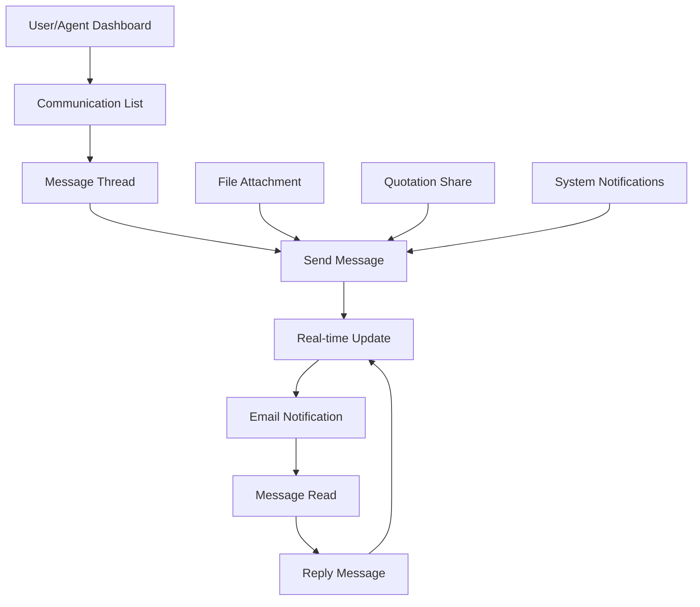

# UI/UX Design for Communication System Interface

## Overview
This document outlines the user interface and experience design for the communication system that enables real-time messaging between users and travel agents, with email notifications and message history.

## Communication Flow



## Page Structure and Components

### 1. Communication List

**Route:** `/app/(pages)/agent/communications/page.js` and `/app/(pages)/user/communications/page.js`

**Component:** `components/pages/communications/CommunicationList.jsx`

```jsx
const CommunicationList = ({ userType }) => {
  const [communications, setCommunications] = useState([]);
  const [activeFilter, setActiveFilter] = useState('all');
  const [searchQuery, setSearchQuery] = useState('');
  const [sortBy, setSortBy] = useState('lastMessageAt');
  const [sortOrder, setSortOrder] = useState('desc');

  const filters = [
    { id: 'all', label: 'All Conversations', count: 0 },
    { id: 'unread', label: 'Unread', count: 0 },
    { id: 'requirements', label: 'Requirements', count: 0 },
    { id: 'quotations', label: 'Quotations', count: 0 },
    { id: 'archived', label: 'Archived', count: 0 }
  ];

  return (
    <div className="communication-list">
      <div className="page-header">
        <h1>Messages</h1>
        <div className="header-actions">
          <button className="btn-primary" onClick={() => handleNewMessage()}>
            New Message
          </button>
        </div>
      </div>

      <div className="communication-filters">
        <div className="search-box">
          <input
            type="text"
            placeholder="Search conversations..."
            value={searchQuery}
            onChange={(e) => setSearchQuery(e.target.value)}
          />
          <button className="search-icon">🔍</button>
        </div>
        
        <div className="filter-tabs">
          {filters.map(filter => (
            <button
              key={filter.id}
              className={`filter-tab ${activeFilter === filter.id ? 'active' : ''}`}
              onClick={() => setActiveFilter(filter.id)}
            >
              {filter.label}
              {filter.count > 0 && (
                <span className="filter-count">{filter.count}</span>
              )}
            </button>
          ))}
        </div>
        
        <div className="sort-controls">
          <label>Sort by:</label>
          <select
            value={sortBy}
            onChange={(e) => setSortBy(e.target.value)}
          >
            <option value="lastMessageAt">Last Message</option>
            <option value="createdAt">Created Date</option>
            <option value="participantName">Participant Name</option>
          </select>
          <button
            className="sort-order"
            onClick={() => setSortOrder(sortOrder === 'asc' ? 'desc' : 'asc')}
          >
            {sortOrder === 'asc' ? '↑' : '↓'}
          </button>
        </div>
      </div>

      <div className="conversations-list">
        {communications.map(communication => (
          <ConversationCard 
            key={communication._id}
            communication={communication}
            currentUserType={userType}
            onClick={() => router.push(`/${userType}/communications/${communication._id}`)}
            onArchive={() => handleArchive(communication._id)}
            onDelete={() => handleDelete(communication._id)}
            onMarkRead={() => handleMarkRead(communication._id)}
          />
        ))}
      </div>

      {communications.length === 0 && (
        <div className="empty-state">
          <div className="empty-icon">💬</div>
          <h3>No Conversations Found</h3>
          <p>
            {activeFilter === 'unread' 
              ? "You don't have any unread messages"
              : "Start a conversation to get in touch with agents or customers"
            }
          </p>
          <button 
            className="btn-primary"
            onClick={() => handleNewMessage()}
          >
            Start New Conversation
          </button>
        </div>
      )}

      <div className="pagination">
        <button 
          className="btn-secondary"
          disabled={currentPage === 1}
          onClick={() => setCurrentPage(currentPage - 1)}
        >
          Previous
        </button>
        <span className="page-info">
          Page {currentPage} of {totalPages}
        </span>
        <button 
          className="btn-secondary"
          disabled={currentPage === totalPages}
          onClick={() => setCurrentPage(currentPage + 1)}
        >
          Next
        </button>
      </div>
    </div>
  );
};

// Conversation Card Component
const ConversationCard = ({ communication, currentUserType, onClick, onArchive, onDelete, onMarkRead }) => {
  const getOtherParticipant = () => {
    const otherParticipant = communication.participants.find(
      p => p.role !== currentUserType
    );
    return otherParticipant?.userId || {};
  };

  const otherParticipant = getOtherParticipant();
  const lastMessage = communication.messages[communication.messages.length - 1];
  const unreadCount = communication.messages.filter(
    msg => msg.senderRole !== currentUserType && 
    !msg.readBy.some(read => read.userId === currentUserId)
  ).length;

  return (
    <div 
      className={`conversation-card ${unreadCount > 0 ? 'unread' : ''}`}
      onClick={onClick}
    >
      <div className="participant-avatar">
        
        {unreadCount > 0 && (
          <span className="unread-badge">{unreadCount}</span>
        )}
      </div>
      
      <div className="conversation-content">
        <div className="conversation-header">
          <h3>
            {otherParticipant.firstName} {otherParticipant.lastName}
          </h3>
          <span className="conversation-time">
            {formatTimeAgo(lastMessage?.sentAt)}
          </span>
        </div>
        
        <div className="conversation-preview">
          <span className="message-type">
            {getMessageTypeIcon(lastMessage?.messageType)}
          </span>
          <p className="message-preview">
            {lastMessage?.messageType === 'quotation' 
              ? `Quotation: ${lastMessage.content}`
              : lastMessage?.content
            }
          </p>
        </div>
        
        <div className="conversation-meta">
          <span className="requirement-title">
            {communication.requirement?.title}
          </span>
          {communication.quotation && (
            <span className="quotation-badge">
              Quotation Sent
            </span>
          )}
        </div>
      </div>
      
      <div className="conversation-actions">
        <button 
          className="btn-icon"
          onClick={(e) => {
            e.stopPropagation();
            onMarkRead(communication._id);
          }}
          title="Mark as read"
        >
          ✓
        </button>
        <button 
          className="btn-icon"
          onClick={(e) => {
            e.stopPropagation();
            onArchive(communication._id);
          }}
          title="Archive conversation"
        >
          📁
        </button>
        <button 
          className="btn-icon danger"
          onClick={(e) => {
            e.stopPropagation();
            onDelete(communication._id);
          }}
          title="Delete conversation"
        >
          🗑️
        </button>
      </div>
    </div>
  );
};
```

### 2. Message Thread View

**Route:** `/app/(pages)/agent/communications/[communicationId]/page.js` and `/app/(pages)/user/communications/[communicationId]/page.js`

**Component:** `components/pages/communications/MessageThread.jsx`

```jsx
const MessageThread = ({ communicationId, currentUserType }) => {
  const [communication, setCommunication] = useState(null);
  const [messages, setMessages] = useState([]);
  const [newMessage, setNewMessage] = useState('');
  const [isTyping, setIsTyping] = useState(false);
  const [isOnline, setIsOnline] = useState(false);
  const [attachmentFiles, setAttachmentFiles] = useState([]);
  const [isRecording, setIsRecording] = useState(false);
  const messagesEndRef = useRef(null);
  const fileInputRef = useRef(null);

  useEffect(() => {
    // Initialize WebSocket connection for real-time messaging
    initializeWebSocket();
    
    // Mark messages as read
    markMessagesAsRead();
    
    return () => {
      // Cleanup WebSocket connection
      cleanupWebSocket();
    };
  }, [communicationId]);

  useEffect(() => {
    scrollToBottom();
  }, [messages]);

  const scrollToBottom = () => {
    messagesEndRef.current?.scrollIntoView({ behavior: 'smooth' });
  };

  const handleSendMessage = () => {
    if (!newMessage.trim() && attachmentFiles.length === 0) return;

    const messageData = {
      content: newMessage.trim(),
      messageType: attachmentFiles.length > 0 ? 'file' : 'text',
      attachments: attachmentFiles.map(file => ({
        filename: file.name,
        url: file.url,
        fileType: file.type
      }))
    };

    sendMessage(messageData);
    setNewMessage('');
    setAttachmentFiles([]);
  };

  const handleFileUpload = (event) => {
    const files = Array.from(event.target.files);
    const validFiles = files.filter(file => {
      const isValidSize = file.size <= 10 * 1024 * 1024; // 10MB limit
      const isValidType = ['image/jpeg', 'image/png', 'application/pdf', 'text/plain', 'application/msword', 'application/vnd.openxmlformats-officedocument.wordprocessingml.document'].includes(file.type);
      return isValidSize && isValidType;
    });

    if (validFiles.length !== files.length) {
      alert('Some files were not added due to size or type restrictions');
    }

    // Upload files and get URLs
    uploadFiles(validFiles).then(uploadedFiles => {
      setAttachmentFiles([...attachmentFiles, ...uploadedFiles]);
    });
  };

  const removeAttachment = (index) => {
    setAttachmentFiles(attachmentFiles.filter((_, i) => i !== index));
  };

  const handleShareQuotation = () => {
    // Open quotation selection modal
    setShowQuotationModal(true);
  };

  const handleVoiceRecord = () => {
    if (isRecording) {
      stopRecording();
    } else {
      startRecording();
    }
  };

  return (
    <div className="message-thread">
      <div className="thread-header">
        <div className="participant-info">
          <button 
            className="back-button"
            onClick={() => router.back()}
          >
            ← Back
          </button>
          
          <div className="participant-avatar">
            
            <span className={`online-status ${isOnline ? 'online' : 'offline'}`}></span>
          </div>
          
          <div className="participant-details">
            <h2>
              {getOtherParticipant()?.firstName} {getOtherParticipant()?.lastName}
            </h2>
            <p className="participant-status">
              {isOnline ? 'Online' : 'Offline'}
              {communication?.requirement && (
                <span> • {communication.requirement.title}</span>
              )}
            </p>
          </div>
        </div>
        
        <div className="thread-actions">
          <button 
            className="btn-icon"
            onClick={handleShareQuotation}
            title="Share quotation"
          >
            📄
          </button>
          <button 
            className="btn-icon"
            onClick={() => setShowInfo(true)}
            title="Conversation info"
          >
            ℹ️
          </button>
          <button 
            className="btn-icon"
            onClick={() => handleArchive(communicationId)}
            title="Archive conversation"
          >
            📁
          </button>
        </div>
      </div>

      <div className="messages-container">
        {messages.map((message, index) => (
          <MessageBubble 
            key={message.messageId}
            message={message}
            isOwn={message.senderRole === currentUserType}
            sender={getSenderInfo(message.senderId)}
            previousMessage={messages[index - 1]}
            nextMessage={messages[index + 1]}
            onReply={() => handleReply(message)}
            onReact={(emoji) => handleReact(message.messageId, emoji)}
          />
        ))}
        
        {isTyping && (
          <div className="typing-indicator">
            <div className="typing-dots">
              <span></span>
              <span></span>
              <span></span>
            </div>
            <span className="typing-text">
              {getOtherParticipant()?.firstName} is typing...
            </span>
          </div>
        )}
        
        <div ref={messagesEndRef} />
      </div>

      <div className="message-input-container">
        {attachmentFiles.length > 0 && (
          <div className="attachment-preview">
            {attachmentFiles.map((file, index) => (
              <div key={index} className="attachment-item">
                <div className="file-icon">
                  {getFileIcon(file.fileType)}
                </div>
                <div className="file-info">
                  <span className="file-name">{file.filename}</span>
                  <span className="file-size">{formatFileSize(file.size)}</span>
                </div>
                <button 
                  className="btn-remove"
                  onClick={() => removeAttachment(index)}
                >
                  ×
                </button>
              </div>
            ))}
          </div>
        )}
        
        <div className="message-input">
          <button 
            className="btn-icon"
            onClick={() => fileInputRef.current?.click()}
            title="Attach file"
          >
            📎
          </button>
          
          <input
            type="text"
            placeholder="Type a message..."
            value={newMessage}
            onChange={(e) => setNewMessage(e.target.value)}
            onKeyPress={(e) => {
              if (e.key === 'Enter' && !e.shiftKey) {
                e.preventDefault();
                handleSendMessage();
              }
            }}
            onFocus={() => handleTypingStart()}
            onBlur={() => handleTypingStop()}
          />
          
          <button 
            className={`btn-icon ${isRecording ? 'recording' : ''}`}
            onClick={handleVoiceRecord}
            title="Voice message"
          >
            {isRecording ? '⏹️' : '🎤'}
          </button>
          
          <button 
            className="btn-primary send-button"
            onClick={handleSendMessage}
            disabled={!newMessage.trim() && attachmentFiles.length === 0}
          >
            Send
          </button>
        </div>
        
        <input
          ref={fileInputRef}
          type="file"
          multiple
          accept="image/*,.pdf,.doc,.docx,.txt"
          onChange={handleFileUpload}
          style={{ display: 'none' }}
        />
      </div>

      {/* Quotation Share Modal */}
      {showQuotationModal && (
        <QuotationShareModal
          requirementId={communication?.requirement?._id}
          onSelect={(quotation) => {
            sendMessage({
              content: quotation.title,
              messageType: 'quotation',
              quotationId: quotation._id
            });
            setShowQuotationModal(false);
          }}
          onClose={() => setShowQuotationModal(false)}
        />
      )}

      {/* Conversation Info Modal */}
      {showInfo && (
        <ConversationInfoModal
          communication={communication}
          currentUserType={currentUserType}
          onClose={() => setShowInfo(false)}
        />
      )}
    </div>
  );
};

// Message Bubble Component
const MessageBubble = ({ message, isOwn, sender, previousMessage, nextMessage, onReply, onReact }) => {
  const [showActions, setShowActions] = useState(false);
  const [showReactions, setShowReactions] = useState(false);
  const [readReceipts, setReadReceipts] = useState(false);

  const isConsecutive = previousMessage && 
    previousMessage.senderId === message.senderId && 
    (new Date(message.sentAt) - new Date(previousMessage.sentAt)) < 60000; // 1 minute

  const messageTime = new Date(message.sentAt).toLocaleTimeString('en-US', {
    hour: '2-digit',
    minute: '2-digit'
  });

  const getReactions = () => {
    // Group reactions by emoji and count
    const reactions = {};
    message.reactions?.forEach(reaction => {
      if (!reactions[reaction.emoji]) {
        reactions[reaction.emoji] = [];
      }
      reactions[reaction.emoji].push(reaction.userId);
    });
    return reactions;
  };

  const reactions = getReactions();

  return (
    <div 
      className={`message-bubble ${isOwn ? 'own' : 'other'} ${isConsecutive ? 'consecutive' : ''}`}
      onMouseEnter={() => setShowActions(true)}
      onMouseLeave={() => setShowActions(false)}
    >
      {!isConsecutive && (
        <div className="message-header">
          {!isOwn && (
            <div className="sender-info">
              
              <span className="sender-name">
                {sender.firstName} {sender.lastName}
              </span>
            </div>
          )}
          <span className="message-time">{messageTime}</span>
        </div>
      )}
      
      <div className="message-content">
        {message.messageType === 'text' && (
          <p className="text-message">{message.content}</p>
        )}
        
        {message.messageType === 'file' && (
          <div className="file-message">
            {message.attachments?.map((attachment, index) => (
              <div key={index} className="attachment-preview">
                <div className="file-icon">
                  {getFileIcon(attachment.fileType)}
                </div>
                <div className="file-details">
                  <span className="file-name">{attachment.filename}</span>
                  <button 
                    className="btn-link download-btn"
                    onClick={() => window.open(attachment.url, '_blank')}
                  >
                    Download
                  </button>
                </div>
              </div>
            ))}
          </div>
        )}
        
        {message.messageType === 'image' && (
          <div className="image-message">
            {message.attachments?.map((attachment, index) => (
               window.open(attachment.url, '_blank')}
              />
            ))}
          </div>
        )}
        
        {message.messageType === 'quotation' && (
          <div className="quotation-message">
            <div className="quotation-card">
              <h4>📄 Quotation Shared</h4>
              <p>{message.content}</p>
              <button 
                className="btn-primary"
                onClick={() => router.push(`/quotations/${message.quotationId}`)}
              >
                View Quotation
              </button>
            </div>
          </div>
        )}
        
        {message.messageType === 'system' && (
          <div className="system-message">
            <p>{message.content}</p>
          </div>
        )}
        
        {message.isEdited && (
          <span className="edited-indicator">(edited)</span>
        )}
      </div>
      
      {/* Message Actions */}
      {showActions && message.messageType !== 'system' && (
        <div className="message-actions">
          <button 
            className="action-btn"
            onClick={() => onReply(message)}
            title="Reply"
          >
            ↩️
          </button>
          <button 
            className="action-btn"
            onClick={() => setShowReactions(!showReactions)}
            title="React"
          >
            😊
          </button>
          {isOwn && (
            <button 
              className="action-btn"
              onClick={() => handleEditMessage(message)}
              title="Edit"
            >
              ✏️
            </button>
          )}
          {isOwn && (
            <button 
              className="action-btn danger"
              onClick={() => handleDeleteMessage(message.messageId)}
              title="Delete"
            >
              🗑️
            </button>
          )}
        </div>
      )}
      
      {/* Reactions */}
      {Object.keys(reactions).length > 0 && (
        <div className="message-reactions">
          {Object.entries(reactions).map(([emoji, users]) => (
            <button 
              key={emoji}
              className="reaction"
              onClick={() => onReact(emoji)}
              title={users.map(userId => getUserById(userId)?.firstName).join(', ')}
            >
              <span className="reaction-emoji">{emoji}</span>
              <span className="reaction-count">{users.length}</span>
            </button>
          ))}
        </div>
      )}
      
      {/* Reaction Picker */}
      {showReactions && (
        <div className="reaction-picker">
          {['👍', '❤️', '😊', '😂', '😮', '😢', '😡'].map(emoji => (
            <button 
              key={emoji}
              className="reaction-option"
              onClick={() => {
                onReact(emoji);
                setShowReactions(false);
              }}
            >
              {emoji}
            </button>
          ))}
        </div>
      )}
      
      {/* Read Receipts */}
      {isOwn && readReceipts && (
        <div className="read-receipts">
          <span className="receipt-icon">✓✓</span>
          <div className="receipt-details">
            {message.readBy?.map(read => (
              
            ))}
          </div>
        </div>
      )}
    </div>
  );
};
```

### 3. Quotation Share Modal

**Component:** `components/pages/communications/QuotationShareModal.jsx`

```jsx
const QuotationShareModal = ({ requirementId, onSelect, onClose }) => {
  const [quotations, setQuotations] = useState([]);
  const [selectedQuotation, setSelectedQuotation] = useState(null);
  const [isLoading, setIsLoading] = useState(true);

  useEffect(() => {
    fetchQuotations();
  }, [requirementId]);

  const fetchQuotations = async () => {
    try {
      const response = await fetch(`/api/travel-agent/quotations/list?requirementId=${requirementId}`);
      const result = await response.json();
      if (result.success) {
        setQuotations(result.data);
      }
    } catch (error) {
      console.error('Error fetching quotations:', error);
    } finally {
      setIsLoading(false);
    }
  };

  const handleSelect = () => {
    if (selectedQuotation) {
      onSelect(selectedQuotation);
    }
  };

  return (
    <div className="modal-overlay">
      <div className="quotation-share-modal">
        <div className="modal-header">
          <h2>Share Quotation</h2>
          <button className="btn-close" onClick={onClose}>
            ×
          </button>
        </div>
        
        <div className="modal-content">
          {isLoading ? (
            <div className="loading">Loading quotations...</div>
          ) : quotations.length === 0 ? (
            <div className="empty-state">
              <h3>No Quotations Available</h3>
              <p>Create a quotation first to share it in the conversation</p>
              <button 
                className="btn-primary"
                onClick={() => {
                  onClose();
                  router.push(`/agent/quotations/create?requirement=${requirementId}`);
                }}
              >
                Create Quotation
              </button>
            </div>
          ) : (
            <>
              <p>Select a quotation to share in the conversation:</p>
              <div className="quotations-list">
                {quotations.map(quotation => (
                  <div 
                    key={quotation._id}
                    className={`quotation-item ${selectedQuotation?._id === quotation._id ? 'selected' : ''}`}
                    onClick={() => setSelectedQuotation(quotation)}
                  >
                    <div className="quotation-info">
                      <h4>{quotation.title}</h4>
                      <p>{quotation.description}</p>
                      <div className="quotation-meta">
                        <span className="price">
                          {quotation.currency} {quotation.totalPrice.toFixed(2)}
                        </span>
                        <span className={`status status-${quotation.status}`}>
                          {quotation.status}
                        </span>
                      </div>
                    </div>
                    <div className="selection-indicator">
                      {selectedQuotation?._id === quotation._id && '✓'}
                    </div>
                  </div>
                ))}
              </div>
            </>
          )}
        </div>
        
        <div className="modal-actions">
          <button className="btn-secondary" onClick={onClose}>
            Cancel
          </button>
          <button 
            className="btn-primary"
            onClick={handleSelect}
            disabled={!selectedQuotation}
          >
            Share Quotation
          </button>
        </div>
      </div>
    </div>
  );
};
```

### 4. Conversation Info Modal

**Component:** `components/pages/communications/ConversationInfoModal.jsx`

```jsx
const ConversationInfoModal = ({ communication, currentUserType, onClose }) => {
  const [sharedFiles, setSharedFiles] = useState([]);
  const [sharedQuotations, setSharedQuotations] = useState([]);

  useEffect(() => {
    extractSharedContent();
  }, [communication]);

  const extractSharedContent = () => {
    const files = [];
    const quotations = [];
    
    communication.messages?.forEach(message => {
      if (message.messageType === 'file' || message.messageType === 'image') {
        files.push(...(message.attachments || []));
      }
      if (message.messageType === 'quotation') {
        quotations.push({
          quotationId: message.quotationId,
          title: message.content,
          sentAt: message.sentAt
        });
      }
    });
    
    setSharedFiles(files);
    setSharedQuotations(quotations);
  };

  const otherParticipant = communication.participants.find(
    p => p.role !== currentUserType
  );

  return (
    <div className="modal-overlay">
      <div className="conversation-info-modal">
        <div className="modal-header">
          <h2>Conversation Info</h2>
          <button className="btn-close" onClick={onClose}>
            ×
          </button>
        </div>
        
        <div className="modal-content">
          <div className="participant-section">
            <h3>Participant</h3>
            <div className="participant-card">
              
              <div className="participant-info">
                <h4>
                  {otherParticipant?.userId?.firstName} {otherParticipant?.userId?.lastName}
                </h4>
                <p>{otherParticipant?.userId?.email}</p>
                <span className={`role-badge ${otherParticipant.role}`}>
                  {otherParticipant.role}
                </span>
              </div>
            </div>
          </div>
          
          <div className="requirement-section">
            <h3>Related Requirement</h3>
            {communication.requirement ? (
              <div className="requirement-card">
                <h4>{communication.requirement.title}</h4>
                <p>{communication.requirement.description}</p>
                <div className="requirement-meta">
                  <span className={`priority priority-${communication.requirement.priority}`}>
                    {communication.requirement.priority}
                  </span>
                  <span className={`status status-${communication.requirement.status}`}>
                    {communication.requirement.status.replace('_', ' ')}
                  </span>
                </div>
                <button 
                  className="btn-link"
                  onClick={() => {
                    onClose();
                    router.push(`/${currentUserType}/requirements/${communication.requirement._id}`);
                  }}
                >
                  View Requirement
                </button>
              </div>
            ) : (
              <p>No requirement associated with this conversation</p>
            )}
          </div>
          
          {sharedFiles.length > 0 && (
            <div className="shared-files-section">
              <h3>Shared Files ({sharedFiles.length})</h3>
              <div className="files-grid">
                {sharedFiles.map((file, index) => (
                  <div key={index} className="file-card">
                    <div className="file-icon">
                      {getFileIcon(file.fileType)}
                    </div>
                    <div className="file-info">
                      <span className="file-name">{file.filename}</span>
                      <span className="file-type">{file.fileType}</span>
                    </div>
                    <button 
                      className="btn-link"
                      onClick={() => window.open(file.url, '_blank')}
                    >
                      Download
                    </button>
                  </div>
                ))}
              </div>
            </div>
          )}
          
          {sharedQuotations.length > 0 && (
            <div className="shared-quotations-section">
              <h3>Shared Quotations ({sharedQuotations.length})</h3>
              <div className="quotations-list">
                {sharedQuotations.map((quotation, index) => (
                  <div key={index} className="quotation-item">
                    <h4>{quotation.title}</h4>
                    <p>Shared on {new Date(quotation.sentAt).toLocaleDateString()}</p>
                    <button 
                      className="btn-link"
                      onClick={() => {
                        onClose();
                        router.push(`/quotations/${quotation.quotationId}`);
                      }}
                    >
                      View Quotation
                    </button>
                  </div>
                ))}
              </div>
            </div>
          )}
          
          <div className="notification-settings">
            <h3>Notification Settings</h3>
            <label className="checkbox-label">
              <input type="checkbox" defaultChecked={true} />
              Email notifications for new messages
            </label>
            <label className="checkbox-label">
              <input type="checkbox" defaultChecked={true} />
              Push notifications for new messages
            </label>
            <label className="checkbox-label">
              <input type="checkbox" defaultChecked={false} />
              Sound notifications
            </label>
          </div>
        </div>
        
        <div className="modal-actions">
          <button className="btn-secondary" onClick={onClose}>
            Close
          </button>
        </div>
      </div>
    </div>
  );
};
```

## Real-time Features Implementation

### WebSocket Connection Management

```jsx
// hooks/useWebSocket.js
export const useWebSocket = (communicationId, currentUserType) => {
  const [socket, setSocket] = useState(null);
  const [isConnected, setIsConnected] = useState(false);
  const [onlineUsers, setOnlineUsers] = useState([]);

  useEffect(() => {
    const wsUrl = `${process.env.NEXT_PUBLIC_WS_URL}/communications/${communicationId}`;
    const newSocket = new WebSocket(wsUrl);

    newSocket.onopen = () => {
      setIsConnected(true);
      setSocket(newSocket);
      
      // Join the communication room
      newSocket.send(JSON.stringify({
        type: 'join',
        data: {
          communicationId,
          userType: currentUserType,
          userId: currentUserId
        }
      }));
    };

    newSocket.onmessage = (event) => {
      const message = JSON.parse(event.data);
      handleWebSocketMessage(message);
    };

    newSocket.onclose = () => {
      setIsConnected(false);
      setSocket(null);
      
      // Attempt to reconnect after 3 seconds
      setTimeout(() => {
        if (communicationId) {
          // Reconnect logic
        }
      }, 3000);
    };

    return () => {
      newSocket.close();
    };
  }, [communicationId, currentUserType]);

  const handleWebSocketMessage = (message) => {
    switch (message.type) {
      case 'new_message':
        addNewMessage(message.data);
        break;
      case 'typing_start':
        setTypingStatus(message.data.userId, true);
        break;
      case 'typing_stop':
        setTypingStatus(message.data.userId, false);
        break;
      case 'user_online':
        setOnlineStatus(message.data.userId, true);
        break;
      case 'user_offline':
        setOnlineStatus(message.data.userId, false);
        break;
      case 'message_read':
        updateReadReceipts(message.data);
        break;
      case 'message_reaction':
        updateMessageReactions(message.data);
        break;
    }
  };

  const sendMessage = (messageData) => {
    if (socket && isConnected) {
      socket.send(JSON.stringify({
        type: 'send_message',
        data: messageData
      }));
    }
  };

  const sendTypingIndicator = (isTyping) => {
    if (socket && isConnected) {
      socket.send(JSON.stringify({
        type: isTyping ? 'typing_start' : 'typing_stop',
        data: { userId: currentUserId }
      }));
    }
  };

  return {
    socket,
    isConnected,
    onlineUsers,
    sendMessage,
    sendTypingIndicator
  };
};
```

## Email Notification Integration

### Email Service for Communication

```jsx
// services/emailService.js
export const sendCommunicationEmail = async (type, data) => {
  const emailTemplates = {
    new_message: {
      subject: `New message from ${data.senderName}`,
      template: 'newMessage',
      data: {
        senderName: data.senderName,
        messageContent: data.messageContent,
        requirementTitle: data.requirementTitle,
        communicationUrl: `${process.env.NEXT_PUBLIC_APP_URL}/communications/${data.communicationId}`
      }
    },
    quotation_shared: {
      subject: `Quotation shared: ${data.quotationTitle}`,
      template: 'quotationShared',
      data: {
        senderName: data.senderName,
        quotationTitle: data.quotationTitle,
        quotationUrl: `${process.env.NEXT_PUBLIC_APP_URL}/quotations/${data.quotationId}`
      }
    }
  };

  const template = emailTemplates[type];
  if (!template) return;

  try {
    await fetch('/api/email/send', {
      method: 'POST',
      headers: {
        'Content-Type': 'application/json'
      },
      body: JSON.stringify({
        to: data.recipientEmail,
        subject: template.subject,
        template: template.template,
        data: template.data
      })
    });
  } catch (error) {
    console.error('Error sending communication email:', error);
  }
};
```

## Responsive Design Considerations

1. **Mobile-First Messaging**: Optimized message bubbles for mobile screens
2. **Touch-Friendly Input**: Appropriate sized input areas and buttons
3. **Swipe Gestures**: Support for swipe to reply/archive actions
4. **Adaptive Layout**: Message thread adapts to screen orientation
5. **Keyboard Support**: Full keyboard accessibility for message input

## Accessibility Features

1. **Keyboard Navigation**: Complete keyboard accessibility
2. **Screen Reader Support**: Proper ARIA labels and roles
3. **Focus Management**: Clear focus indicators in message thread
4. **Color Contrast**: Sufficient contrast for message bubbles
5. **Alternative Text**: Descriptive text for attachments and images

## Performance Considerations

1. **Message Virtualization**: Virtual scrolling for long message histories
2. **Image Lazy Loading**: Load images as they come into view
3. **WebSocket Optimization**: Efficient real-time connection management
4. **Caching Strategy**: Cache messages and user data locally
5. **Progressive Loading**: Load recent messages first, then older ones

## Security Considerations

1. **Message Encryption**: Encrypt sensitive message content
2. **File Validation**: Validate all uploaded files
3. **XSS Prevention**: Sanitize message content
4. **Rate Limiting**: Prevent message spam
5. **Access Control**: Ensure users can only access their conversations