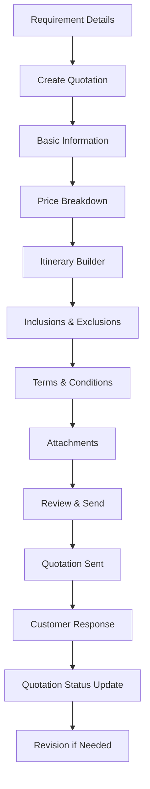

# UI/UX Design for Quotation Management System Interface

## Overview
This document outlines the user interface and experience design for the quotation management system, allowing agents to create, edit, send, and manage quotations for travel requirements.

## Quotation Management Flow



## Page Structure and Components

### 1. Create Quotation

**Route:** `/app/(pages)/agent/quotations/create/page.js`

**Component:** `components/pages/agent/CreateQuotation.jsx`

```jsx
const CreateQuotation = () => {
  const [requirement, setRequirement] = useState(null);
  const [currentStep, setCurrentStep] = useState(1);
  const [quotationData, setQuotationData] = useState({
    title: '',
    description: '',
    validUntil: '',
    currency: 'USD',
    totalPrice: 0,
    priceBreakdown: [],
    itinerary: [],
    inclusions: [],
    exclusions: [],
    termsAndConditions: [],
    attachments: []
  });
  const [isSaving, setIsSaving] = useState(false);

  const steps = [
    { id: 1, title: 'Basic Information', icon: '📝' },
    { id: 2, title: 'Price Breakdown', icon: '💰' },
    { id: 3, title: 'Itinerary', icon: '🗺️' },
    { id: 4, title: 'Inclusions & Exclusions', icon: '📋' },
    { id: 5, title: 'Terms & Conditions', icon: '📄' },
    { id: 6, title: 'Attachments', icon: '📎' },
    { id: 7, title: 'Review & Send', icon: '✅' }
  ];

  return (
    <div className="create-quotation">
      <div className="quotation-header">
        <div className="header-content">
          <h1>Create Quotation</h1>
          <div className="requirement-summary">
            <h3>{requirement?.title}</h3>
            <p>{requirement?.user?.firstName} {requirement?.user?.lastName}</p>
            <span className={`priority-badge priority-${requirement?.priority}`}>
              {requirement?.priority}
            </span>
          </div>
        </div>
        <div className="header-actions">
          <button 
            className="btn-secondary" 
            onClick={() => saveDraft()}
            disabled={isSaving}
          >
            {isSaving ? 'Saving...' : 'Save Draft'}
          </button>
          <button 
            className="btn-outline"
            onClick={() => router.back()}
          >
            Cancel
          </button>
        </div>
      </div>

      {/* Progress Steps */}
      <div className="steps-container">
        <div className="steps">
          {steps.map((step, index) => (
            <div 
              key={step.id}
              className={`step ${currentStep === step.id ? 'active' : ''} ${currentStep > step.id ? 'completed' : ''}`}
              onClick={() => currentStep > step.id && setCurrentStep(step.id)}
            >
              <div className="step-icon">{step.icon}</div>
              <div className="step-title">{step.title}</div>
            </div>
          ))}
        </div>
      </div>

      {/* Step Content */}
      <div className="step-content">
        {currentStep === 1 && (
          <BasicInformationStep
            data={quotationData}
            requirement={requirement}
            onChange={setQuotationData}
            onNext={() => setCurrentStep(2)}
          />
        )}
        {currentStep === 2 && (
          <PriceBreakdownStep
            data={quotationData}
            requirement={requirement}
            onChange={setQuotationData}
            onNext={() => setCurrentStep(3)}
            onBack={() => setCurrentStep(1)}
          />
        )}
        {currentStep === 3 && (
          <ItineraryStep
            data={quotationData}
            requirement={requirement}
            onChange={setQuotationData}
            onNext={() => setCurrentStep(4)}
            onBack={() => setCurrentStep(2)}
          />
        )}
        {currentStep === 4 && (
          <InclusionsStep
            data={quotationData}
            onChange={setQuotationData}
            onNext={() => setCurrentStep(5)}
            onBack={() => setCurrentStep(3)}
          />
        )}
        {currentStep === 5 && (
          <TermsStep
            data={quotationData}
            onChange={setQuotationData}
            onNext={() => setCurrentStep(6)}
            onBack={() => setCurrentStep(4)}
          />
        )}
        {currentStep === 6 && (
          <AttachmentsStep
            data={quotationData}
            onChange={setQuotationData}
            onNext={() => setCurrentStep(7)}
            onBack={() => setCurrentStep(5)}
          />
        )}
        {currentStep === 7 && (
          <ReviewStep
            data={quotationData}
            requirement={requirement}
            onSend={handleSendQuotation}
            onBack={() => setCurrentStep(6)}
          />
        )}
      </div>
    </div>
  );
};

// Basic Information Step Component
const BasicInformationStep = ({ data, requirement, onChange, onNext }) => {
  const [formData, setFormData] = useState({
    title: data.title || `Quotation for ${requirement?.title}`,
    description: data.description || '',
    validUntil: data.validUntil || getDefaultValidUntil(),
    currency: data.currency || 'USD'
  });

  const handleSubmit = (e) => {
    e.preventDefault();
    onChange({...data, ...formData});
    onNext();
  };

  return (
    <div className="step-form">
      <h2>Basic Information</h2>
      <p>Provide the basic details for your quotation</p>
      
      <form onSubmit={handleSubmit}>
        <div className="form-group">
          <label htmlFor="title">Quotation Title *</label>
          <input
            type="text"
            id="title"
            value={formData.title}
            onChange={(e) => setFormData({...formData, title: e.target.value})}
            required
          />
        </div>
        
        <div className="form-group">
          <label htmlFor="description">Description *</label>
          <textarea
            id="description"
            rows={4}
            value={formData.description}
            onChange={(e) => setFormData({...formData, description: e.target.value})}
            placeholder="Provide a detailed description of the travel package you're offering..."
            required
          />
        </div>
        
        <div className="form-row">
          <div className="form-group">
            <label htmlFor="currency">Currency *</label>
            <select
              id="currency"
              value={formData.currency}
              onChange={(e) => setFormData({...formData, currency: e.target.value})}
              required
            >
              <option value="USD">USD ($)</option>
              <option value="EUR">EUR (€)</option>
              <option value="GBP">GBP (£)</option>
              <option value="JPY">JPY (¥)</option>
            </select>
          </div>
          
          <div className="form-group">
            <label htmlFor="validUntil">Valid Until *</label>
            <input
              type="date"
              id="validUntil"
              value={formData.validUntil}
              onChange={(e) => setFormData({...formData, validUntil: e.target.value})}
              min={new Date().toISOString().split('T')[0]}
              required
            />
          </div>
        </div>
        
        <div className="form-actions">
          <div className="requirement-summary-box">
            <h4>Requirement Summary</h4>
            <p><strong>Destination:</strong> {requirement?.travelDetails?.destinations?.[0]?.city}</p>
            <p><strong>Departure:</strong> {new Date(requirement?.travelDetails?.departureDate).toLocaleDateString()}</p>
            <p><strong>Passengers:</strong> {requirement?.travelDetails?.passengers?.adults} Adults, {requirement?.travelDetails?.passengers?.children} Children</p>
            {requirement?.travelDetails?.budget?.max && (
              <p><strong>Budget:</strong> {requirement.travelDetails.budget.currency} {requirement.travelDetails.budget.max}</p>
            )}
          </div>
          
          <button type="submit" className="btn-primary">
            Next: Price Breakdown
          </button>
        </div>
      </form>
    </div>
  );
};

// Price Breakdown Step Component
const PriceBreakdownStep = ({ data, requirement, onChange, onNext, onBack }) => {
  const [priceBreakdown, setPriceBreakdown] = useState(data.priceBreakdown || [
    {
      category: 'flights',
      description: 'Round trip airfare',
      quantity: requirement?.travelDetails?.passengers?.adults + requirement?.travelDetails?.passengers?.children || 1,
      unitPrice: 0,
      totalPrice: 0,
      commission: 0,
      taxes: 0,
      fees: 0
    }
  ]);
  
  const [totalPrice, setTotalPrice] = useState(data.totalPrice || 0);

  const categories = [
    { value: 'flights', label: 'Flights' },
    { value: 'hotels', label: 'Hotels' },
    { value: 'transportation', label: 'Transportation' },
    { value: 'meals', label: 'Meals' },
    { value: 'activities', label: 'Activities' },
    { value: 'insurance', label: 'Insurance' },
    { value: 'visa', label: 'Visa' },
    { value: 'other', label: 'Other' }
  ];

  const addPriceItem = () => {
    setPriceBreakdown([...priceBreakdown, {
      category: 'other',
      description: '',
      quantity: 1,
      unitPrice: 0,
      totalPrice: 0,
      commission: 0,
      taxes: 0,
      fees: 0
    }]);
  };

  const updatePriceItem = (index, field, value) => {
    const updatedItems = [...priceBreakdown];
    updatedItems[index][field] = value;
    
    // Calculate total price when unit price or quantity changes
    if (field === 'unitPrice' || field === 'quantity') {
      updatedItems[index].totalPrice = updatedItems[index].unitPrice * updatedItems[index].quantity;
    }
    
    // Calculate commission, taxes, and fees if not manually set
    if (field === 'totalPrice' && !updatedItems[index].commission) {
      updatedItems[index].commission = updatedItems[index].totalPrice * 0.1; // 10% commission
    }
    
    setPriceBreakdown(updatedItems);
    
    // Update total price
    const newTotal = updatedItems.reduce((sum, item) => sum + item.totalPrice + item.commission + item.taxes + item.fees, 0);
    setTotalPrice(newTotal);
  };

  const removePriceItem = (index) => {
    const updatedItems = priceBreakdown.filter((_, i) => i !== index);
    setPriceBreakdown(updatedItems);
    
    const newTotal = updatedItems.reduce((sum, item) => sum + item.totalPrice + item.commission + item.taxes + item.fees, 0);
    setTotalPrice(newTotal);
  };

  const handleSubmit = () => {
    onChange({...data, priceBreakdown, totalPrice});
    onNext();
  };

  return (
    <div className="step-form">
      <h2>Price Breakdown</h2>
      <p>Provide a detailed breakdown of all costs</p>
      
      <div className="price-breakdown-container">
        <div className="price-items">
          {priceBreakdown.map((item, index) => (
            <div key={index} className="price-item">
              <div className="item-header">
                <select
                  value={item.category}
                  onChange={(e) => updatePriceItem(index, 'category', e.target.value)}
                >
                  {categories.map(cat => (
                    <option key={cat.value} value={cat.value}>{cat.label}</option>
                  ))}
                </select>
                <button 
                  type="button"
                  className="btn-remove"
                  onClick={() => removePriceItem(index)}
                  disabled={priceBreakdown.length === 1}
                >
                  Remove
                </button>
              </div>
              
              <div className="item-details">
                <input
                  type="text"
                  placeholder="Description"
                  value={item.description}
                  onChange={(e) => updatePriceItem(index, 'description', e.target.value)}
                />
                
                <div className="item-row">
                  <div className="input-group">
                    <label>Quantity</label>
                    <input
                      type="number"
                      min="1"
                      value={item.quantity}
                      onChange={(e) => updatePriceItem(index, 'quantity', parseInt(e.target.value) || 0)}
                    />
                  </div>
                  
                  <div className="input-group">
                    <label>Unit Price</label>
                    <input
                      type="number"
                      min="0"
                      step="0.01"
                      value={item.unitPrice}
                      onChange={(e) => updatePriceItem(index, 'unitPrice', parseFloat(e.target.value) || 0)}
                    />
                  </div>
                  
                  <div className="input-group">
                    <label>Total Price</label>
                    <input
                      type="number"
                      min="0"
                      step="0.01"
                      value={item.totalPrice}
                      onChange={(e) => updatePriceItem(index, 'totalPrice', parseFloat(e.target.value) || 0)}
                    />
                  </div>
                </div>
                
                <div className="item-row">
                  <div className="input-group">
                    <label>Commission</label>
                    <input
                      type="number"
                      min="0"
                      step="0.01"
                      value={item.commission}
                      onChange={(e) => updatePriceItem(index, 'commission', parseFloat(e.target.value) || 0)}
                    />
                  </div>
                  
                  <div className="input-group">
                    <label>Taxes</label>
                    <input
                      type="number"
                      min="0"
                      step="0.01"
                      value={item.taxes}
                      onChange={(e) => updatePriceItem(index, 'taxes', parseFloat(e.target.value) || 0)}
                    />
                  </div>
                  
                  <div className="input-group">
                    <label>Fees</label>
                    <input
                      type="number"
                      min="0"
                      step="0.01"
                      value={item.fees}
                      onChange={(e) => updatePriceItem(index, 'fees', parseFloat(e.target.value) || 0)}
                    />
                  </div>
                </div>
              </div>
            </div>
          ))}
        </div>
        
        <button type="button" className="btn-add" onClick={addPriceItem}>
          + Add Price Item
        </button>
      </div>
      
      <div className="price-summary">
        <div className="summary-row">
          <span>Subtotal:</span>
          <span>{data.currency} {priceBreakdown.reduce((sum, item) => sum + item.totalPrice, 0).toFixed(2)}</span>
        </div>
        <div className="summary-row">
          <span>Commission:</span>
          <span>{data.currency} {priceBreakdown.reduce((sum, item) => sum + item.commission, 0).toFixed(2)}</span>
        </div>
        <div className="summary-row">
          <span>Taxes:</span>
          <span>{data.currency} {priceBreakdown.reduce((sum, item) => sum + item.taxes, 0).toFixed(2)}</span>
        </div>
        <div className="summary-row">
          <span>Fees:</span>
          <span>{data.currency} {priceBreakdown.reduce((sum, item) => sum + item.fees, 0).toFixed(2)}</span>
        </div>
        <div className="summary-row total">
          <span>Total Price:</span>
          <span>{data.currency} {totalPrice.toFixed(2)}</span>
        </div>
      </div>
      
      <div className="form-actions">
        <button type="button" className="btn-secondary" onClick={onBack}>
          Back
        </button>
        <button type="button" className="btn-primary" onClick={handleSubmit}>
          Next: Itinerary
        </button>
      </div>
    </div>
  );
};

// Itinerary Step Component
const ItineraryStep = ({ data, requirement, onChange, onNext, onBack }) => {
  const [itinerary, setItinerary] = useState(data.itinerary || []);
  const [activeDay, setActiveDay] = useState(0);

  const addDay = () => {
    const newDay = {
      day: itinerary.length + 1,
      date: calculateDateForDay(itinerary.length + 1, requirement?.travelDetails?.departureDate),
      title: `Day ${itinerary.length + 1}`,
      description: '',
      activities: [],
      accommodation: {},
      transportation: {}
    };
    setItinerary([...itinerary, newDay]);
  };

  const updateDay = (dayIndex, field, value) => {
    const updatedItinerary = [...itinerary];
    updatedItinerary[dayIndex][field] = value;
    setItinerary(updatedItinerary);
  };

  const addActivity = (dayIndex) => {
    const updatedItinerary = [...itinerary];
    updatedItinerary[dayIndex].activities.push({
      time: '',
      activity: '',
      location: '',
      details: ''
    });
    setItinerary(updatedItinerary);
  };

  const removeDay = (dayIndex) => {
    const updatedItinerary = itinerary.filter((_, index) => index !== dayIndex);
    // Renumber days
    const renumberedItinerary = updatedItinerary.map((day, index) => ({
      ...day,
      day: index + 1,
      title: `Day ${index + 1}`
    }));
    setItinerary(renumberedItinerary);
  };

  const handleSubmit = () => {
    onChange({...data, itinerary});
    onNext();
  };

  return (
    <div className="step-form">
      <h2>Travel Itinerary</h2>
      <p>Create a detailed day-by-day itinerary for the trip</p>
      
      <div className="itinerary-builder">
        <div className="itinerary-sidebar">
          <div className="day-tabs">
            {itinerary.map((day, index) => (
              <button
                key={index}
                className={`day-tab ${activeDay === index ? 'active' : ''}`}
                onClick={() => setActiveDay(index)}
              >
                Day {day.day}
                <span className="day-date">{new Date(day.date).toLocaleDateString('en-US', { month: 'short', day: 'numeric' })}</span>
              </button>
            ))}
            <button type="button" className="add-day-btn" onClick={addDay}>
              + Add Day
            </button>
          </div>
        </div>
        
        <div className="itinerary-content">
          {itinerary.length > 0 && activeDay < itinerary.length && (
            <div className="day-editor">
              <div className="day-header">
                <h3>Day {itinerary[activeDay].day}</h3>
                <div className="day-actions">
                  <input
                    type="date"
                    value={itinerary[activeDay].date}
                    onChange={(e) => updateDay(activeDay, 'date', e.target.value)}
                  />
                  <button 
                    type="button"
                    className="btn-remove"
                    onClick={() => removeDay(activeDay)}
                    disabled={itinerary.length === 1}
                  >
                    Remove Day
                  </button>
                </div>
              </div>
              
              <div className="day-form">
                <div className="form-group">
                  <label>Day Title</label>
                  <input
                    type="text"
                    value={itinerary[activeDay].title}
                    onChange={(e) => updateDay(activeDay, 'title', e.target.value)}
                    placeholder="e.g., Arrival in Paris"
                  />
                </div>
                
                <div className="form-group">
                  <label>Description</label>
                  <textarea
                    rows={3}
                    value={itinerary[activeDay].description}
                    onChange={(e) => updateDay(activeDay, 'description', e.target.value)}
                    placeholder="Describe the main activities and highlights of this day"
                  />
                </div>
                
                <div className="activities-section">
                  <div className="section-header">
                    <h4>Activities</h4>
                    <button 
                      type="button"
                      className="btn-add"
                      onClick={() => addActivity(activeDay)}
                    >
                      + Add Activity
                    </button>
                  </div>
                  
                  {itinerary[activeDay].activities.map((activity, actIndex) => (
                    <div key={actIndex} className="activity-item">
                      <div className="activity-row">
                        <div className="input-group">
                          <label>Time</label>
                          <input
                            type="time"
                            value={activity.time}
                            onChange={(e) => {
                              const updatedActivities = [...itinerary[activeDay].activities];
                              updatedActivities[actIndex].time = e.target.value;
                              updateDay(activeDay, 'activities', updatedActivities);
                            }}
                          />
                        </div>
                        <div className="input-group">
                          <label>Activity</label>
                          <input
                            type="text"
                            value={activity.activity}
                            onChange={(e) => {
                              const updatedActivities = [...itinerary[activeDay].activities];
                              updatedActivities[actIndex].activity = e.target.value;
                              updateDay(activeDay, 'activities', updatedActivities);
                            }}
                            placeholder="e.g., City tour"
                          />
                        </div>
                      </div>
                      <div className="activity-row">
                        <div className="input-group">
                          <label>Location</label>
                          <input
                            type="text"
                            value={activity.location}
                            onChange={(e) => {
                              const updatedActivities = [...itinerary[activeDay].activities];
                              updatedActivities[actIndex].location = e.target.value;
                              updateDay(activeDay, 'activities', updatedActivities);
                            }}
                            placeholder="e.g., Eiffel Tower"
                          />
                        </div>
                        <div className="input-group">
                          <label>Details</label>
                          <input
                            type="text"
                            value={activity.details}
                            onChange={(e) => {
                              const updatedActivities = [...itinerary[activeDay].activities];
                              updatedActivities[actIndex].details = e.target.value;
                              updateDay(activeDay, 'activities', updatedActivities);
                            }}
                            placeholder="Additional details"
                          />
                        </div>
                        <button 
                          type="button"
                          className="btn-remove"
                          onClick={() => {
                            const updatedActivities = itinerary[activeDay].activities.filter((_, i) => i !== actIndex);
                            updateDay(activeDay, 'activities', updatedActivities);
                          }}
                        >
                          Remove
                        </button>
                      </div>
                    </div>
                  ))}
                </div>
                
                <div className="accommodation-section">
                  <h4>Accommodation</h4>
                  <div className="accommodation-form">
                    <div className="input-group">
                      <label>Hotel Name</label>
                      <input
                        type="text"
                        value={itinerary[activeDay].accommodation?.name || ''}
                        onChange={(e) => updateDay(activeDay, 'accommodation', {
                          ...itinerary[activeDay].accommodation,
                          name: e.target.value
                        })}
                        placeholder="Hotel name"
                      />
                    </div>
                    <div className="input-group">
                      <label>Rating</label>
                      <input
                        type="number"
                        min="1"
                        max="5"
                        value={itinerary[activeDay].accommodation?.rating || ''}
                        onChange={(e) => updateDay(activeDay, 'accommodation', {
                          ...itinerary[activeDay].accommodation,
                          rating: parseInt(e.target.value)
                        })}
                        placeholder="1-5 stars"
                      />
                    </div>
                    <div className="input-group">
                      <label>Room Type</label>
                      <input
                        type="text"
                        value={itinerary[activeDay].accommodation?.roomType || ''}
                        onChange={(e) => updateDay(activeDay, 'accommodation', {
                          ...itinerary[activeDay].accommodation,
                          roomType: e.target.value
                        })}
                        placeholder="e.g., Deluxe Room"
                      />
                    </div>
                  </div>
                </div>
                
                <div className="transportation-section">
                  <h4>Transportation</h4>
                  <div className="transportation-form">
                    <div className="input-group">
                      <label>Type</label>
                      <select
                        value={itinerary[activeDay].transportation?.type || ''}
                        onChange={(e) => updateDay(activeDay, 'transportation', {
                          ...itinerary[activeDay].transportation,
                          type: e.target.value
                        })}
                      >
                        <option value="">Select type</option>
                        <option value="flight">Flight</option>
                        <option value="car">Car</option>
                        <option value="train">Train</option>
                        <option value="bus">Bus</option>
                        <option value="walking">Walking</option>
                      </select>
                    </div>
                    <div className="input-group">
                      <label>Details</label>
                      <input
                        type="text"
                        value={itinerary[activeDay].transportation?.details || ''}
                        onChange={(e) => updateDay(activeDay, 'transportation', {
                          ...itinerary[activeDay].transportation,
                          details: e.target.value
                        })}
                        placeholder="e.g., Flight AF123"
                      />
                    </div>
                  </div>
                </div>
              </div>
            </div>
          )}
          
          {itinerary.length === 0 && (
            <div className="empty-itinerary">
              <h3>No Days Added</h3>
              <p>Start building your itinerary by adding days</p>
              <button type="button" className="btn-primary" onClick={addDay}>
                Add First Day
              </button>
            </div>
          )}
        </div>
      </div>
      
      <div className="form-actions">
        <button type="button" className="btn-secondary" onClick={onBack}>
          Back
        </button>
        <button type="button" className="btn-primary" onClick={handleSubmit}>
          Next: Inclusions & Exclusions
        </button>
      </div>
    </div>
  );
};
```

### 2. Quotation List Management

**Route:** `/app/(pages)/agent/quotations/page.js`

**Component:** `components/pages/agent/QuotationsList.jsx`

```jsx
const QuotationsList = () => {
  const [quotations, setQuotations] = useState([]);
  const [filters, setFilters] = useState({
    status: '',
    dateRange: '',
    requirementId: '',
    agentId: ''
  });
  const [searchQuery, setSearchQuery] = useState('');
  const [sortBy, setSortBy] = useState('createdAt');
  const [sortOrder, setSortOrder] = useState('desc');

  const statusOptions = [
    { value: 'draft', label: 'Draft', color: 'gray' },
    { value: 'sent', label: 'Sent', color: 'blue' },
    { value: 'viewed', label: 'Viewed', color: 'purple' },
    { value: 'accepted', label: 'Accepted', color: 'green' },
    { value: 'rejected', label: 'Rejected', color: 'red' },
    { value: 'expired', label: 'Expired', color: 'orange' },
    { value: 'withdrawn', label: 'Withdrawn', color: 'gray' }
  ];

  return (
    <div className="quotations-list">
      <div className="page-header">
        <h1>Quotations Management</h1>
        <div className="header-actions">
          <button 
            className="btn-primary"
            onClick={() => router.push('/agent/quotations/create')}
          >
            Create New Quotation
          </button>
        </div>
      </div>

      <div className="filters-section">
        <div className="search-box">
          <input
            type="text"
            placeholder="Search quotations..."
            value={searchQuery}
            onChange={(e) => setSearchQuery(e.target.value)}
          />
          <button className="search-icon">🔍</button>
        </div>
        
        <div className="filter-controls">
          <select
            value={filters.status}
            onChange={(e) => setFilters({...filters, status: e.target.value})}
          >
            <option value="">All Statuses</option>
            {statusOptions.map(status => (
              <option key={status.value} value={status.value}>{status.label}</option>
            ))}
          </select>
          
          <input
            type="date"
            value={filters.dateRange}
            onChange={(e) => setFilters({...filters, dateRange: e.target.value})}
            placeholder="Date Range"
          />
          
          <select
            value={sortBy}
            onChange={(e) => setSortBy(e.target.value)}
          >
            <option value="createdAt">Created Date</option>
            <option value="sentAt">Sent Date</option>
            <option value="validUntil">Valid Until</option>
            <option value="totalPrice">Price</option>
          </select>
          
          <button
            className="sort-order"
            onClick={() => setSortOrder(sortOrder === 'asc' ? 'desc' : 'asc')}
          >
            {sortOrder === 'asc' ? '↑' : '↓'}
          </button>
        </div>
      </div>

      <div className="quotations-grid">
        {quotations.map(quotation => (
          <QuotationCard 
            key={quotation._id}
            quotation={quotation}
            onView={() => router.push(`/agent/quotations/${quotation._id}`)}
            onEdit={() => router.push(`/agent/quotations/${quotation._id}/edit`)}
            onSend={() => handleSendQuotation(quotation._id)}
            onWithdraw={() => handleWithdrawQuotation(quotation._id)}
            onDuplicate={() => handleDuplicateQuotation(quotation._id)}
          />
        ))}
      </div>

      {quotations.length === 0 && (
        <div className="empty-state">
          <div className="empty-icon">📄</div>
          <h3>No Quotations Found</h3>
          <p>Get started by creating your first quotation</p>
          <button 
            className="btn-primary"
            onClick={() => router.push('/agent/quotations/create')}
          >
            Create Quotation
          </button>
        </div>
      )}

      <div className="pagination">
        <button 
          className="btn-secondary"
          disabled={currentPage === 1}
          onClick={() => setCurrentPage(currentPage - 1)}
        >
          Previous
        </button>
        <span className="page-info">
          Page {currentPage} of {totalPages}
        </span>
        <button 
          className="btn-secondary"
          disabled={currentPage === totalPages}
          onClick={() => setCurrentPage(currentPage + 1)}
        >
          Next
        </button>
      </div>
    </div>
  );
};

// Quotation Card Component
const QuotationCard = ({ quotation, onView, onEdit, onSend, onWithdraw, onDuplicate }) => {
  const statusColors = {
    draft: 'gray',
    sent: 'blue',
    viewed: 'purple',
    accepted: 'green',
    rejected: 'red',
    expired: 'orange',
    withdrawn: 'gray'
  };

  const getDaysUntilExpiry = (validUntil) => {
    const today = new Date();
    const expiryDate = new Date(validUntil);
    const diffTime = expiryDate - today;
    const diffDays = Math.ceil(diffTime / (1000 * 60 * 60 * 24));
    return diffDays;
  };

  return (
    <div className="quotation-card">
      <div className="card-header">
        <h3>{quotation.title}</h3>
        <span className={`status-badge status-${statusColors[quotation.status]}`}>
          {quotation.status}
        </span>
      </div>
      
      <div className="card-content">
        <div className="quotation-info">
          <p className="requirement-title">{quotation.requirement?.title}</p>
          <p className="customer-name">
            {quotation.requirement?.user?.firstName} {quotation.requirement?.user?.lastName}
          </p>
          <div className="quotation-meta">
            <span className="quotation-id">#{quotation.quotationId}</span>
            <span className="created-date">
              Created: {new Date(quotation.createdAt).toLocaleDateString()}
            </span>
            {quotation.sentAt && (
              <span className="sent-date">
                Sent: {new Date(quotation.sentAt).toLocaleDateString()}
              </span>
            )}
          </div>
        </div>
        
        <div className="price-info">
          <div className="price">
            <span className="currency">{quotation.currency}</span>
            <span className="amount">{quotation.totalPrice.toFixed(2)}</span>
          </div>
          {quotation.validUntil && (
            <div className={`validity ${getDaysUntilExpiry(quotation.validUntil) <= 3 ? 'expiring-soon' : ''}`}>
              Valid until: {new Date(quotation.validUntil).toLocaleDateString()}
              <span className="days-left">
                ({getDaysUntilExpiry(quotation.validUntil)} days left)
              </span>
            </div>
          )}
        </div>
      </div>
      
      <div className="card-actions">
        <button className="btn-primary" onClick={onView}>
          View
        </button>
        
        {quotation.status === 'draft' && (
          <>
            <button className="btn-secondary" onClick={onEdit}>
              Edit
            </button>
            <button className="btn-primary" onClick={onSend}>
              Send
            </button>
          </>
        )}
        
        {(quotation.status === 'sent' || quotation.status === 'viewed') && (
          <>
            <button className="btn-secondary" onClick={onEdit}>
              Revise
            </button>
            <button className="btn-outline" onClick={onWithdraw}>
              Withdraw
            </button>
          </>
        )}
        
        <button className="btn-link" onClick={onDuplicate}>
          Duplicate
        </button>
      </div>
    </div>
  );
};
```

### 3. Quotation Details View

**Route:** `/app/(pages)/agent/quotations/[quotationId]/page.js`

**Component:** `components/pages/agent/QuotationDetails.jsx`

```jsx
const QuotationDetails = ({ quotationId }) => {
  const [quotation, setQuotation] = useState(null);
  const [activeTab, setActiveTab] = useState('overview');
  const [isEditing, setIsEditing] = useState(false);

  const tabs = [
    { id: 'overview', label: 'Overview' },
    { id: 'breakdown', label: 'Price Breakdown' },
    { id: 'itinerary', label: 'Itinerary' },
    { id: 'communication', label: 'Communication' },
    { id: 'history', label: 'History' }
  ];

  return (
    <div className="quotation-details">
      <div className="quotation-header">
        <div className="header-content">
          <div className="breadcrumb">
            <button onClick={() => router.push('/agent/quotations')}>
              Quotations
            </button>
            <span>/</span>
            <span>{quotation?.quotationId}</span>
          </div>
          
          <div className="quotation-title-section">
            <h1>{quotation?.title}</h1>
            <div className="quotation-badges">
              <span className={`status-badge status-${quotation?.status}`}>
                {quotation?.status}
              </span>
              <span className="quotation-id">#{quotation?.quotationId}</span>
            </div>
          </div>
        </div>
        
        <div className="header-actions">
          {quotation?.status === 'draft' && (
            <>
              <button 
                className="btn-primary"
                onClick={() => router.push(`/agent/quotations/${quotationId}/edit`)}
              >
                Edit Quotation
              </button>
              <button 
                className="btn-secondary"
                onClick={() => handleSendQuotation()}
              >
                Send Quotation
              </button>
            </>
          )}
          
          {(quotation?.status === 'sent' || quotation?.status === 'viewed') && (
            <>
              <button 
                className="btn-primary"
                onClick={() => router.push(`/agent/quotations/${quotationId}/revise`)}
              >
                Revise Quotation
              </button>
              <button 
                className="btn-outline"
                onClick={() => handleWithdrawQuotation()}
              >
                Withdraw
              </button>
            </>
          )}
          
          <button className="btn-secondary" onClick={() => window.print()}>
            Print
          </button>
          <button className="btn-secondary" onClick={() => handleDuplicateQuotation()}>
            Duplicate
          </button>
        </div>
      </div>

      {/* Customer Information */}
      <div className="customer-info-card">
        <h3>Customer Information</h3>
        <div className="customer-details">
          <div className="customer-avatar">
            
          </div>
          <div className="customer-info">
            <h4>
              {quotation?.requirement?.user?.firstName} {quotation?.requirement?.user?.lastName}
            </h4>
            <p>{quotation?.requirement?.user?.email}</p>
            {quotation?.requirement?.user?.phoneNumbers?.[0] && (
              <p>
                {quotation.requirement.user.phoneNumbers[0].dialCode} 
                {quotation.requirement.user.phoneNumbers[0].number}
              </p>
            )}
          </div>
          <div className="quotation-status">
            <div className="status-item">
              <span className="label">Created:</span>
              <span className="value">{new Date(quotation?.createdAt).toLocaleDateString()}</span>
            </div>
            {quotation?.sentAt && (
              <div className="status-item">
                <span className="label">Sent:</span>
                <span className="value">{new Date(quotation.sentAt).toLocaleDateString()}</span>
              </div>
            )}
            {quotation?.viewedAt && (
              <div className="status-item">
                <span className="label">Viewed:</span>
                <span className="value">{new Date(quotation.viewedAt).toLocaleDateString()}</span>
              </div>
            )}
            {quotation?.validUntil && (
              <div className="status-item">
                <span className="label">Valid Until:</span>
                <span className={`value ${isExpired(quotation.validUntil) ? 'expired' : ''}`}>
                  {new Date(quotation.validUntil).toLocaleDateString()}
                </span>
              </div>
            )}
          </div>
        </div>
      </div>

      {/* Price Summary */}
      <div className="price-summary-card">
        <h3>Price Summary</h3>
        <div className="price-breakdown">
          <div className="summary-row">
            <span>Subtotal:</span>
            <span>{quotation?.currency} {quotation?.priceBreakdown?.reduce((sum, item) => sum + item.totalPrice, 0).toFixed(2)}</span>
          </div>
          <div className="summary-row">
            <span>Commission:</span>
            <span>{quotation?.currency} {quotation?.priceBreakdown?.reduce((sum, item) => sum + item.commission, 0).toFixed(2)}</span>
          </div>
          <div className="summary-row">
            <span>Taxes:</span>
            <span>{quotation?.currency} {quotation?.priceBreakdown?.reduce((sum, item) => sum + item.taxes, 0).toFixed(2)}</span>
          </div>
          <div className="summary-row">
            <span>Fees:</span>
            <span>{quotation?.currency} {quotation?.priceBreakdown?.reduce((sum, item) => sum + item.fees, 0).toFixed(2)}</span>
          </div>
          <div className="summary-row total">
            <span>Total Price:</span>
            <span>{quotation?.currency} {quotation?.totalPrice?.toFixed(2)}</span>
          </div>
        </div>
      </div>

      {/* Tabs Content */}
      <div className="tabs-content">
        <div className="tabs">
          {tabs.map(tab => (
            <button
              key={tab.id}
              className={`tab ${activeTab === tab.id ? 'active' : ''}`}
              onClick={() => setActiveTab(tab.id)}
            >
              {tab.label}
            </button>
          ))}
        </div>

        {/* Overview Tab */}
        {activeTab === 'overview' && (
          <div className="tab-content">
            <div className="overview-section">
              <h3>Quotation Overview</h3>
              <div className="description-section">
                <h4>Description</h4>
                <p>{quotation?.description}</p>
              </div>
              
              {quotation?.inclusions?.length > 0 && (
                <div className="inclusions-section">
                  <h4>Inclusions</h4>
                  <ul>
                    {quotation.inclusions.map((inclusion, index) => (
                      <li key={index}>{inclusion}</li>
                    ))}
                  </ul>
                </div>
              )}
              
              {quotation?.exclusions?.length > 0 && (
                <div className="exclusions-section">
                  <h4>Exclusions</h4>
                  <ul>
                    {quotation.exclusions.map((exclusion, index) => (
                      <li key={index}>{exclusion}</li>
                    ))}
                  </ul>
                </div>
              )}
              
              {quotation?.termsAndConditions?.length > 0 && (
                <div className="terms-section">
                  <h4>Terms & Conditions</h4>
                  <ul>
                    {quotation.termsAndConditions.map((term, index) => (
                      <li key={index}>{term}</li>
                    ))}
                  </ul>
                </div>
              )}
            </div>
          </div>
        )}

        {/* Price Breakdown Tab */}
        {activeTab === 'breakdown' && (
          <div className="tab-content">
            <div className="price-breakdown-section">
              <h3>Detailed Price Breakdown</h3>
              <div className="breakdown-table">
                <table>
                  <thead>
                    <tr>
                      <th>Category</th>
                      <th>Description</th>
                      <th>Quantity</th>
                      <th>Unit Price</th>
                      <th>Total Price</th>
                      <th>Commission</th>
                      <th>Taxes</th>
                      <th>Fees</th>
                    </tr>
                  </thead>
                  <tbody>
                    {quotation?.priceBreakdown?.map((item, index) => (
                      <tr key={index}>
                        <td>{item.category}</td>
                        <td>{item.description}</td>
                        <td>{item.quantity}</td>
                        <td>{quotation.currency} {item.unitPrice.toFixed(2)}</td>
                        <td>{quotation.currency} {item.totalPrice.toFixed(2)}</td>
                        <td>{quotation.currency} {item.commission.toFixed(2)}</td>
                        <td>{quotation.currency} {item.taxes.toFixed(2)}</td>
                        <td>{quotation.currency} {item.fees.toFixed(2)}</td>
                      </tr>
                    ))}
                  </tbody>
                  <tfoot>
                    <tr className="total-row">
                      <td colSpan="4">Total</td>
                      <td>{quotation?.currency} {quotation?.priceBreakdown?.reduce((sum, item) => sum + item.totalPrice, 0).toFixed(2)}</td>
                      <td>{quotation?.currency} {quotation?.priceBreakdown?.reduce((sum, item) => sum + item.commission, 0).toFixed(2)}</td>
                      <td>{quotation?.currency} {quotation?.priceBreakdown?.reduce((sum, item) => sum + item.taxes, 0).toFixed(2)}</td>
                      <td>{quotation?.currency} {quotation?.priceBreakdown?.reduce((sum, item) => sum + item.fees, 0).toFixed(2)}</td>
                    </tr>
                  </tfoot>
                </table>
              </div>
            </div>
          </div>
        )}

        {/* Itinerary Tab */}
        {activeTab === 'itinerary' && (
          <div className="tab-content">
            <div className="itinerary-section">
              <h3>Travel Itinerary</h3>
              <div className="itinerary-days">
                {quotation?.itinerary?.map((day, index) => (
                  <div key={index} className="itinerary-day">
                    <div className="day-header">
                      <h4>Day {day.day}: {day.title}</h4>
                      <span className="day-date">{new Date(day.date).toLocaleDateString()}</span>
                    </div>
                    
                    {day.description && (
                      <p className="day-description">{day.description}</p>
                    )}
                    
                    {day.activities?.length > 0 && (
                      <div className="day-activities">
                        <h5>Activities</h5>
                        {day.activities.map((activity, actIndex) => (
                          <div key={actIndex} className="activity">
                            <div className="activity-time">{activity.time}</div>
                            <div className="activity-content">
                              <h6>{activity.activity}</h6>
                              {activity.location && <p className="activity-location">📍 {activity.location}</p>}
                              {activity.details && <p className="activity-details">{activity.details}</p>}
                            </div>
                          </div>
                        ))}
                      </div>
                    )}
                    
                    {day.accommodation && Object.keys(day.accommodation).length > 0 && (
                      <div className="day-accommodation">
                        <h5>Accommodation</h5>
                        <div className="accommodation-details">
                          {day.accommodation.name && <p><strong>Hotel:</strong> {day.accommodation.name}</p>}
                          {day.accommodation.rating && <p><strong>Rating:</strong> {day.accommodation.rating} stars</p>}
                          {day.accommodation.roomType && <p><strong>Room Type:</strong> {day.accommodation.roomType}</p>}
                        </div>
                      </div>
                    )}
                    
                    {day.transportation && Object.keys(day.transportation).length > 0 && (
                      <div className="day-transportation">
                        <h5>Transportation</h5>
                        <div className="transportation-details">
                          {day.transportation.type && <p><strong>Type:</strong> {day.transportation.type}</p>}
                          {day.transportation.details && <p><strong>Details:</strong> {day.transportation.details}</p>}
                        </div>
                      </div>
                    )}
                  </div>
                ))}
              </div>
            </div>
          </div>
        )}

        {/* Communication Tab */}
        {activeTab === 'communication' && (
          <div className="tab-content">
            <CommunicationThread 
              requirementId={quotation?.requirement?._id}
              quotationId={quotationId}
            />
          </div>
        )}

        {/* History Tab */}
        {activeTab === 'history' && (
          <div className="tab-content">
            <div className="history-section">
              <h3>Quotation History</h3>
              <div className="timeline">
                <div className="timeline-item">
                  <div className="timeline-icon created">📝</div>
                  <div className="timeline-content">
                    <h4>Quotation Created</h4>
                    <p>Initial quotation was created</p>
                    <span className="timeline-date">
                      {new Date(quotation?.createdAt).toLocaleString()}
                    </span>
                  </div>
                </div>
                
                {quotation?.sentAt && (
                  <div className="timeline-item">
                    <div className="timeline-icon sent">📤</div>
                    <div className="timeline-content">
                      <h4>Quotation Sent</h4>
                      <p>Quotation was sent to the customer</p>
                      <span className="timeline-date">
                        {new Date(quotation.sentAt).toLocaleString()}
                      </span>
                    </div>
                  </div>
                )}
                
                {quotation?.viewedAt && (
                  <div className="timeline-item">
                    <div className="timeline-icon viewed">👁️</div>
                    <div className="timeline-content">
                      <h4>Quotation Viewed</h4>
                      <p>Customer viewed the quotation</p>
                      <span className="timeline-date">
                        {new Date(quotation.viewedAt).toLocaleString()}
                      </span>
                    </div>
                  </div>
                )}
                
                {quotation?.revisionHistory?.map((revision, index) => (
                  <div key={index} className="timeline-item">
                    <div className="timeline-icon revised">✏️</div>
                    <div className="timeline-content">
                      <h4>Revision {revision.revisionNumber}</h4>
                      <p>{revision.changes}</p>
                      <span className="timeline-date">
                        {new Date(revision.revisedAt).toLocaleString()}
                      </span>
                    </div>
                  </div>
                ))}
              </div>
            </div>
          </div>
        )}
      </div>
    </div>
  );
};
```

## Responsive Design Considerations

1. **Mobile-First Quotation Cards**: Compact view with essential information
2. **Adaptive Forms**: Forms that adapt to different screen sizes
3. **Touch-Friendly Interface**: Appropriate button sizes and spacing
4. **Collapsible Sections**: Expandable/collapsible sections for mobile
5. **Swipe Gestures**: Support for swipe navigation between quotation steps

## Accessibility Features

1. **Keyboard Navigation**: Full keyboard accessibility for all interactive elements
2. **Screen Reader Support**: Proper ARIA labels and descriptions
3. **Focus Management**: Clear focus indicators and logical tab order
4. **Color Contrast**: Sufficient contrast ratios for text readability
5. **Alternative Text**: Descriptive alt text for images and icons

## Performance Considerations

1. **Lazy Loading**: Load quotations and details on demand
2. **Virtual Scrolling**: For long lists of quotations
3. **Image Optimization**: Compress attachments and images
4. **Caching Strategy**: Cache frequently accessed quotation data
5. **Progressive Loading**: Load essential content first, then enhancements

## Error Handling and Validation

1. **Form Validation**: Real-time validation with clear error messages
2. **Auto-Save**: Automatically save quotation drafts
3. **Network Error Handling**: Graceful handling of API failures
4. **Data Persistence**: Save form state to prevent data loss
5. **User Feedback**: Clear feedback for all user actions