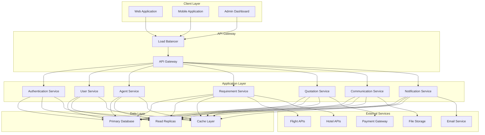
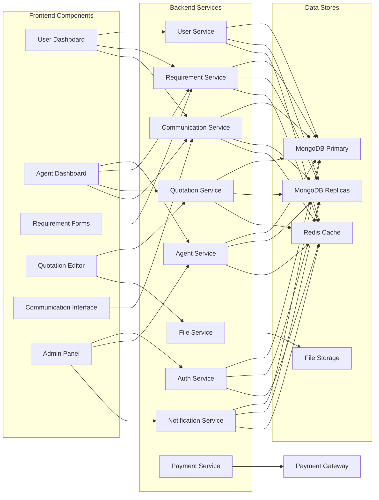
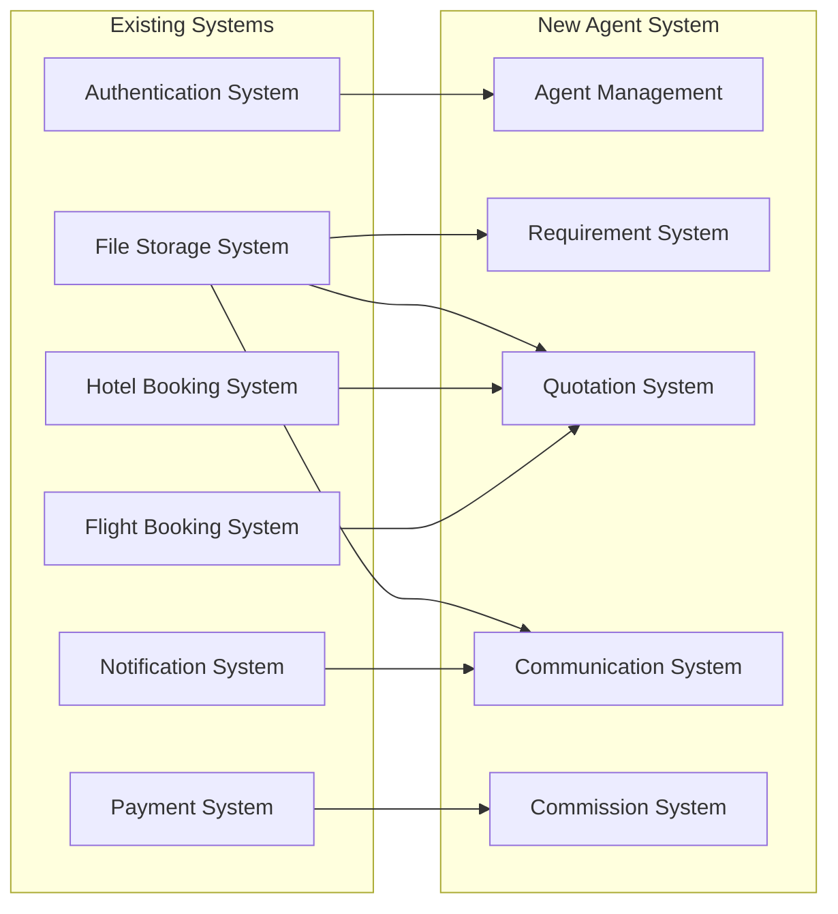
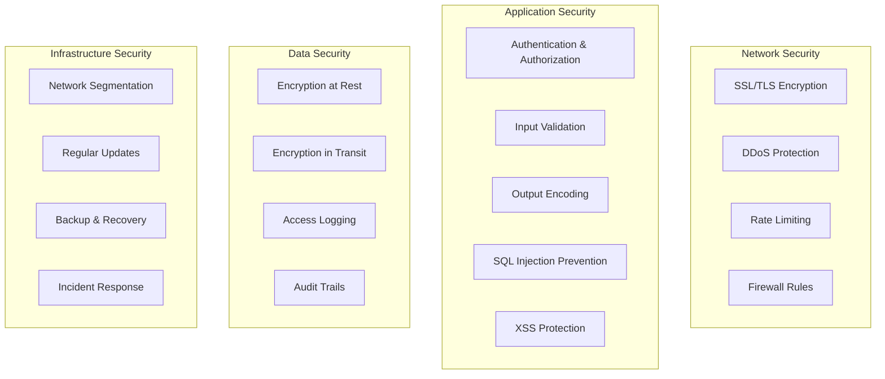
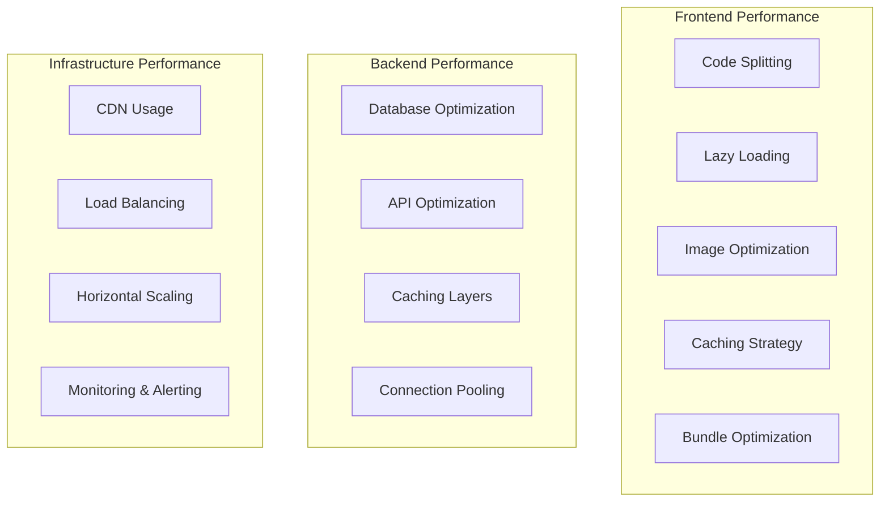
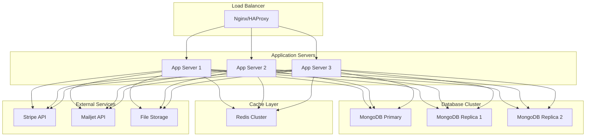

# Travel Agent Requirement System - Complete Architecture Documentation

## Table of Contents
1. [System Overview](#system-overview)
2. [Architecture Principles](#architecture-principles)
3. [System Architecture](#system-architecture)
4. [Database Design](#database-design)
5. [API Design](#api-design)
6. [User Interface Design](#user-interface-design)
7. [Integration Strategy](#integration-strategy)
8. [Security Architecture](#security-architecture)
9. [Performance Considerations](#performance-considerations)
10. [Deployment Architecture](#deployment-architecture)
11. [Implementation Roadmap](#implementation-roadmap)

## System Overview

The Travel Agent Requirement System is a comprehensive platform that connects travelers with professional travel agents, enabling personalized travel planning and quotation services. The system extends the existing Golobe Travel Agency application while maintaining compatibility with current flight and hotel booking systems.

### Key Features
- **Travel Requirement Submission**: Users can submit detailed travel requirements
- **Agent Management**: Professional profiles with specializations and verification
- **Quotation System**: Standalone quotations with detailed pricing and itineraries
- **Real-time Communication**: Hybrid chat system with email notifications
- **Commission Management**: Automated commission calculation and payment processing
- **Analytics & Reporting**: Performance metrics for agents and administrators

### User Roles
- **Customers**: Submit travel requirements and communicate with agents
- **Agents**: Create quotations, manage requirements, and provide travel expertise
- **Administrators**: Oversee system operations, verify agents, and manage configurations

## Architecture Principles

### 1. Modularity
The system is designed with clear separation of concerns, allowing independent development and maintenance of components:
- Frontend components are modular and reusable
- Backend services are loosely coupled
- Database schemas are normalized and related
- External integrations are abstracted through interfaces

### 2. Scalability
The architecture supports horizontal scaling:
- Database sharding for large datasets
- Load balancing for application servers
- Caching at multiple levels
- WebSocket connection management for real-time features

### 3. Security
Security is implemented at multiple layers:
- Authentication and authorization with role-based access control
- Data encryption for sensitive information
- Input validation and sanitization
- Rate limiting and DDoS protection

### 4. Maintainability
The system is designed for long-term maintenance:
- Clear code organization and documentation
- Comprehensive testing strategy
- Monitoring and alerting systems
- Database migration management

## System Architecture

### High-Level Architecture



### Component Architecture



## Database Design

### Entity Relationship Diagram

```mermaid
erDiagram
    User ||--o{ AgentProfile : has
    User ||--o{ TravelRequirement : submits
    User ||--o{ Communication : participates
    User ||--o{ Quotation : receives
    
    AgentProfile ||--o{ TravelRequirement : assigned
    AgentProfile ||--o{ Quotation : creates
    AgentProfile ||--o{ Commission : earns
    
    TravelRequirement ||--o{ Quotation : has
    TravelRequirement ||--o{ Communication : has
    
    Quotation ||--o{ Communication : shared_in
    Quotation ||--o{ Commission : generates
    
    Communication ||--o{ Message : contains
    
    User {
        string id PK
        string firstName
        string lastName
        string email
        string profileImage
        array roles
        object agentData
        datetime createdAt
        datetime updatedAt
    }
    
    AgentProfile {
        string id PK
        string userId FK
        string agentType
        object professionalDetails
        array specializations
        object availability
        object performance
        object verification
        string status
        object commission
        datetime createdAt
        datetime updatedAt
    }
    
    TravelRequirement {
        string id PK
        string userId FK
        string title
        string description
        string category
        string priority
        object travelDetails
        array attachments
        string status
        string assignedAgent FK
        datetime deadline
        datetime submittedAt
        datetime completedAt
        array tags
        boolean isPublic
        datetime createdAt
        datetime updatedAt
    }
    
    Quotation {
        string id PK
        string requirementId FK
        string agentId FK
        string title
        string description
        datetime validUntil
        string currency
        number totalPrice
        array priceBreakdown
        array itinerary
        array inclusions
        array exclusions
        array termsAndConditions
        array attachments
        string status
        datetime sentAt
        datetime viewedAt
        datetime respondedAt
        string responseNotes
        object paymentLink
        object commissionDetails
        array revisionHistory
        datetime createdAt
        datetime updatedAt
    }
    
    Communication {
        string id PK
        string requirementId FK
        string quotationId FK
        array participants
        array messages
        string status
        datetime lastMessageAt
        object emailNotifications
        datetime createdAt
        datetime updatedAt
    }
    
    Message {
        string id PK
        string senderId FK
        string senderRole
        string content
        string messageType
        array attachments
        datetime sentAt
        array readBy
        boolean isEdited
        datetime editedAt
        string replyTo
    }
    
    Commission {
        string id PK
        string agentId FK
        string quotationId FK
        number amount
        string type
        string status
        datetime createdAt
        datetime processedAt
        string transferId
        string error
    }
```



### Database Schema Summary

#### Core Collections
1. **User** - Extended existing user model with roles and agent data
2. **AgentProfile** - Professional profiles and specializations
3. **TravelRequirement** - Customer travel requirements
4. **Quotation** - Agent quotations with pricing and itineraries
5. **Communication** - Message threads between users and agents
6. **Message** - Individual messages within communications
7. **Commission** - Agent commission tracking and payments

#### Supporting Collections
- **Session** - User authentication sessions
- **Notification** - System notifications for users
- **Analytics** - Performance and usage metrics
- **File** - File metadata and storage references

## API Design

### API Architecture

```mermaid
graph TB
    subgraph "API Gateway"
        A[Authentication]
        B[Rate Limiting]
        C[Input Validation]
        D[CORS]
        E[Logging]
    end
    
    subgraph "API Routes"
        F[/api/auth/*]
        G[/api/travel-agent/*]
        H[/api/flights/*]
        I[/api/hotels/*]
        J[/api/stripe/*]
        K[/api/communications/*]
        L[/api/files/*]
        M[/api/notifications/*]
    end
    
    subgraph "Service Layer"
        N[Auth Service]
        O[Agent Service]
        P[Requirement Service]
        Q[Quotation Service]
        R[Communication Service]
        S[File Service]
        T[Notification Service]
    end
    
    A --> F
    A --> G
    B --> F
    B --> G
    C --> F
    C --> G
    D --> F
    D --> G
    E --> F
    E --> G
    
    F --> N
    G --> O
    G --> P
    G --> Q
    G --> R
    G --> S
    G --> T
```

### API Endpoint Categories

#### Authentication Endpoints
- `POST /api/auth/[...nextauth]` - NextAuth authentication
- `GET /api/auth/me` - Get current user profile
- `POST /api/auth/logout` - Logout user

#### Agent Management Endpoints
- `POST /api/travel-agent/profile/create` - Create agent profile
- `GET /api/travel-agent/profile/[agentId]` - Get agent profile
- `PUT /api/travel-agent/profile/[agentId]` - Update agent profile
- `GET /api/travel-agent/agents/list` - List agents with filters
- `POST /api/travel-agent/agents/[agentId]/verify` - Verify agent

#### Requirement Management Endpoints
- `POST /api/travel-agent/requirements/create` - Create requirement
- `GET /api/travel-agent/requirements/[requirementId]` - Get requirement details
- `PUT /api/travel-agent/requirements/[requirementId]` - Update requirement
- `GET /api/travel-agent/requirements/list` - List requirements with filters
- `POST /api/travel-agent/requirements/[requirementId]/submit` - Submit requirement
- `POST /api/travel-agent/requirements/[requirementId]/assign` - Assign agent to requirement

#### Quotation Management Endpoints
- `POST /api/travel-agent/quotations/create` - Create quotation
- `GET /api/travel-agent/quotations/[quotationId]` - Get quotation details
- `PUT /api/travel-agent/quotations/[quotationId]` - Update quotation
- `GET /api/travel-agent/quotations/list` - List quotations with filters
- `POST /api/travel-agent/quotations/[quotationId]/send` - Send quotation
- `POST /api/travel-agent/quotations/[quotationId]/accept` - Accept quotation
- `POST /api/travel-agent/quotations/[quotationId]/reject` - Reject quotation

#### Communication Endpoints
- `GET /api/travel-agent/communications/[communicationId]` - Get communication thread
- `GET /api/travel-agent/communications/requirement/[requirementId]` - Get communication by requirement
- `POST /api/travel-agent/communications/[communicationId]/messages` - Send message
- `POST /api/travel-agent/communications/[communicationId]/read` - Mark messages as read

### API Response Format

#### Standard Success Response
```json
{
  "success": true,
  "data": {
    // Response data
  },
  "message": "Operation successful",
  "meta": {
    "timestamp": "2023-12-14T23:47:28.809Z",
    "requestId": "req_123456789",
    "pagination": {
      "page": 1,
      "limit": 20,
      "total": 100,
      "hasNext": true
    }
  }
}
```

#### Error Response Format
```json
{
  "success": false,
  "data": null,
  "error": {
    "code": "VALIDATION_ERROR",
    "message": "Invalid input data",
    "details": {
      "field": "email",
      "issue": "Invalid email format"
    }
  },
  "meta": {
    "timestamp": "2023-12-14T23:47:28.809Z",
    "requestId": "req_123456789"
  }
}
```

## User Interface Design

### Component Hierarchy

```mermaid
graph TD
    A[App Layout] --> B[User Layout]
    A --> C[Agent Layout]
    A --> D[Admin Layout]
    
    B --> E[User Dashboard]
    B --> F[Requirement Forms]
    B --> G[Communications]
    B --> H[My Bookings]
    
    C --> I[Agent Dashboard]
    C --> J[Requirements Management]
    C --> K[Quotations Management]
    C --> L[Profile Management]
    C --> M[Analytics]
    
    D --> N[System Configuration]
    D --> O[User Management]
    D --> P[Agent Verification]
    D --> Q[System Analytics]
    
    F --> R[Requirement Type Selection]
    F --> S[Basic Information]
    F --> T[Travel Details]
    F --> U[Preferences & Budget]
    F --> V[Attachments]
    F --> W[Review & Submit]
    
    K --> X[Quotation Editor]
    K --> Y[Price Breakdown]
    K --> Z[Itinerary Builder]
    K --> AA[Inclusions & Exclusions]
    K --> BB[Terms & Conditions]
    
    G --> CC[Message List]
    G --> DD[Message Thread]
    G --> EE[File Attachments]
    G --> FF[Quotation Sharing]
```



### Responsive Design Strategy

#### Breakpoint System
- **Mobile**: 320px - 768px
- **Tablet**: 768px - 1024px
- **Desktop**: 1024px - 1440px
- **Large Desktop**: 1440px+

#### Component Adaptation
- **Mobile First**: Design for mobile first, then enhance for larger screens
- **Progressive Enhancement**: Core functionality works without JavaScript
- **Touch Optimization**: Appropriate touch targets and gestures
- **Performance Optimization**: Lazy loading and code splitting

### Accessibility Features

#### WCAG 2.1 AA Compliance
- **Keyboard Navigation**: Full keyboard accessibility
- **Screen Reader Support**: Proper ARIA labels and roles
- **Color Contrast**: Minimum 4.5:1 contrast ratio
- **Focus Management**: Clear focus indicators and logical tab order
- **Alternative Text**: Descriptive alt text for images and icons

## Integration Strategy

### Integration Points



### Integration Patterns

#### 1. Authentication Integration
- Extend existing NextAuth configuration
- Add role-based access control
- Implement agent profile linking
- Maintain backward compatibility

#### 2. Booking System Integration
- Leverage existing flight and hotel APIs
- Create quotation-to-booking conversion
- Maintain separate payment flows
- Sync booking status updates

#### 3. Payment Integration
- Extend existing Stripe integration
- Add quotation payment processing
- Implement commission distribution
- Maintain payment security standards

## Security Architecture

### Security Layers



### Security Measures

#### Authentication & Authorization
- **Multi-Factor Authentication**: Optional 2FA for sensitive operations
- **Role-Based Access Control**: Granular permissions by role
- **Session Management**: Secure session handling with expiration
- **API Key Management**: Secure API key generation and rotation

#### Data Protection
- **Encryption**: AES-256 encryption for sensitive data
- **Hashing**: bcrypt for password hashing
- **Token Security**: JWT with short expiration and refresh tokens
- **Data Masking**: PII masking in logs and non-secure environments

#### Input Validation
- **Schema Validation**: Zod schemas for all inputs
- **File Upload Security**: Type checking, size limits, virus scanning
- **SQL Injection Prevention**: Parameterized queries and ORM usage
- **XSS Prevention**: Output encoding and CSP headers

## Performance Considerations

### Performance Optimization Strategy



### Key Performance Metrics

#### Frontend Metrics
- **First Contentful Paint (FCP)**: < 1.5 seconds
- **Largest Contentful Paint (LCP)**: < 2.5 seconds
- **First Input Delay (FID)**: < 100 milliseconds
- **Cumulative Layout Shift (CLS)**: < 0.1

#### Backend Metrics
- **API Response Time**: < 200 milliseconds (95th percentile)
- **Database Query Time**: < 100 milliseconds (95th percentile)
- **Cache Hit Rate**: > 80%
- **Error Rate**: < 0.1%

#### System Metrics
- **Uptime**: > 99.9%
- **Throughput**: 1000+ requests per second
- **Memory Usage**: < 80% of allocated memory
- **CPU Usage**: < 70% average load

## Deployment Architecture

### Production Deployment



### Deployment Strategy

#### Blue-Green Deployment
- **Zero Downtime**: Seamless deployment with traffic switching
- **Rollback Capability**: Quick rollback if issues detected
- **Health Checks**: Automated health verification
- **Gradual Traffic Shift**: Progressive traffic migration

#### Container Orchestration
- **Docker Containers**: Consistent runtime environments
- **Kubernetes Deployment**: Scalable container management
- **Service Discovery**: Automatic service registration
- **Configuration Management**: Externalized configuration

## Implementation Roadmap

### Phase 1: Foundation (Weeks 1-4)
1. **Database Schema Implementation**
   - Create new collections and indexes
   - Implement data migration scripts
   - Set up database replication

2. **Core Authentication**
   - Extend user model with roles
   - Implement role-based access control
   - Update authentication middleware

3. **Basic API Development**
   - Implement agent profile endpoints
   - Create requirement management APIs
   - Set up basic quotation endpoints

### Phase 2: Core Features (Weeks 5-8)
1. **Requirement System**
   - Complete requirement submission flow
   - Implement requirement assignment logic
   - Add requirement filtering and search

2. **Quotation System**
   - Build quotation creation interface
   - Implement price breakdown functionality
   - Add itinerary builder

3. **Communication System**
   - Set up WebSocket server
   - Implement real-time messaging
   - Add email notification integration

### Phase 3: Advanced Features (Weeks 9-12)
1. **Payment Integration**
   - Implement quotation payment processing
   - Add commission calculation system
   - Set up automated commission payments

2. **Analytics & Reporting**
   - Implement performance tracking
   - Create agent analytics dashboard
   - Add administrative reports

3. **File Management**
   - Implement file upload system
   - Add file validation and security
   - Set up file storage integration

### Phase 4: Optimization & Testing (Weeks 13-16)
1. **Performance Optimization**
   - Implement caching strategies
   - Optimize database queries
   - Add performance monitoring

2. **Security Hardening**
   - Conduct security audit
   - Implement additional security measures
   - Set up security monitoring

3. **Testing & QA**
   - Comprehensive testing suite
   - Load testing and optimization
   - User acceptance testing

### Phase 5: Deployment & Launch (Weeks 17-20)
1. **Production Deployment**
   - Set up production infrastructure
   - Implement CI/CD pipeline
   - Configure monitoring and alerting

2. **Launch Preparation**
   - User training materials
   - Documentation completion
   - Support team preparation

3. **Post-Launch Support**
   - Monitor system performance
   - Address issues and bugs
   - Plan future enhancements

## Conclusion

The Travel Agent Requirement System architecture provides a comprehensive, scalable, and secure platform for connecting travelers with professional travel agents. The system extends the existing Golobe Travel Agency application while maintaining compatibility and leveraging current investments.

### Key Success Factors
1. **Modular Design**: Allows independent development and maintenance
2. **Scalability**: Supports growth in users and transactions
3. **Security**: Protects sensitive data and prevents unauthorized access
4. **Performance**: Ensures responsive user experience
5. **Integration**: Leverages existing systems and investments
6. **Maintainability**: Supports long-term evolution and enhancement

This architecture provides a solid foundation for implementing a world-class travel agent requirement system that can grow with the business and adapt to changing market requirements.