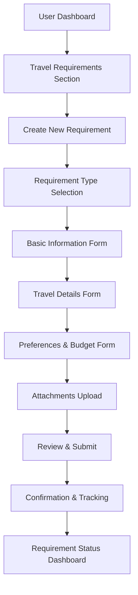

# UI/UX Design for User Requirement Submission Flow

## Overview
This document outlines the user interface and experience design for the travel requirement submission process in the travel agent requirement system.

## User Journey Flow



## Page Structure and Components

### 1. Access Point - User Dashboard

**Location:** `/app/(pages)/user/dashboard/page.js`

**New Section Added:**
```jsx
// Travel Requirements Section
<section className="travel-requirements-section">
  <div className="section-header">
    <h2>Travel Requirements</h2>
    <button className="btn-primary" onClick={handleCreateRequirement}>
      Create New Requirement
    </button>
  </div>
  
  {/* Requirements Summary Cards */}
  <div className="requirements-summary">
    <div className="summary-card">
      <h3>Active Requirements</h3>
      <p className="count">{activeRequirementsCount}</p>
    </div>
    <div className="summary-card">
      <h3>Pending Quotations</h3>
      <p className="count">{pendingQuotationsCount}</p>
    </div>
    <div className="summary-card">
      <h3>Completed</h3>
      <p className="count">{completedRequirementsCount}</p>
    </div>
  </div>
  
  {/* Recent Requirements List */}
  <div className="recent-requirements">
    <h3>Recent Requirements</h3>
    <RequirementList requirements={recentRequirements} />
  </div>
</section>
```

### 2. Requirement Type Selection

**Route:** `/app/(pages)/user/requirements/create/type`

**Component:** `components/pages/requirements/RequirementTypeSelection.jsx`

```jsx
const RequirementTypeSelection = () => {
  const requirementTypes = [
    {
      id: 'flights',
      title: 'Flight Booking',
      description: 'Get help with flight reservations and itineraries',
      icon: '✈️',
      recommended: false
    },
    {
      id: 'hotels',
      title: 'Hotel Accommodation',
      description: 'Find the perfect place to stay',
      icon: '🏨',
      recommended: false
    },
    {
      id: 'packages',
      title: 'Travel Packages',
      description: 'Complete vacation packages with everything included',
      icon: '🌍',
      recommended: true
    },
    {
      id: 'cruises',
      title: 'Cruise Vacations',
      description: 'Sea voyages and cruise experiences',
      icon: '🚢',
      recommended: false
    },
    {
      id: 'car_rentals',
      title: 'Car Rentals',
      description: 'Vehicle rentals for your trips',
      icon: '🚗',
      recommended: false
    },
    {
      id: 'insurance',
      title: 'Travel Insurance',
      description: 'Comprehensive travel insurance coverage',
      icon: '🛡️',
      recommended: false
    },
    {
      id: 'visa',
      title: 'Visa Assistance',
      description: 'Help with visa applications and documentation',
      icon: '📋',
      recommended: false
    },
    {
      id: 'custom',
      title: 'Custom Request',
      description: 'Something else not listed above',
      icon: '✨',
      recommended: false
    }
  ];

  return (
    <div className="requirement-type-selection">
      <div className="progress-indicator">
        <div className="step active">1</div>
        <div className="step">2</div>
        <div className="step">3</div>
        <div className="step">4</div>
        <div className="step">5</div>
      </div>
      
      <h1>What type of travel assistance do you need?</h1>
      <p>Select the category that best matches your requirements</p>
      
      <div className="type-grid">
        {requirementTypes.map(type => (
          <div 
            key={type.id}
            className={`type-card ${type.recommended ? 'recommended' : ''}`}
            onClick={() => handleTypeSelection(type.id)}
          >
            {type.recommended && <span className="recommended-badge">Popular</span>}
            <div className="type-icon">{type.icon}</div>
            <h3>{type.title}</h3>
            <p>{type.description}</p>
          </div>
        ))}
      </div>
      
      <div className="navigation-buttons">
        <button className="btn-secondary" onClick={() => router.back()}>
          Back
        </button>
      </div>
    </div>
  );
};
```

### 3. Basic Information Form

**Route:** `/app/(pages)/user/requirements/create/basic-info`

**Component:** `components/pages/requirements/BasicInfoForm.jsx`

```jsx
const BasicInfoForm = ({ requirementType, onNext, onBack }) => {
  const [formData, setFormData] = useState({
    title: '',
    description: '',
    priority: 'medium',
    deadline: '',
    isPublic: true,
    tags: []
  });

  const priorityOptions = [
    { value: 'low', label: 'Low Priority', color: 'green' },
    { value: 'medium', label: 'Medium Priority', color: 'blue' },
    { value: 'high', label: 'High Priority', color: 'orange' },
    { value: 'urgent', label: 'Urgent', color: 'red' }
  ];

  return (
    <div className="basic-info-form">
      <div className="progress-indicator">
        <div className="step completed">1</div>
        <div className="step active">2</div>
        <div className="step">3</div>
        <div className="step">4</div>
        <div className="step">5</div>
      </div>
      
      <h1>Tell us about your travel requirements</h1>
      
      <form onSubmit={handleSubmit}>
        <div className="form-group">
          <label htmlFor="title">Title *</label>
          <input
            type="text"
            id="title"
            placeholder="e.g., European Summer Vacation"
            value={formData.title}
            onChange={(e) => setFormData({...formData, title: e.target.value})}
            required
          />
        </div>
        
        <div className="form-group">
          <label htmlFor="description">Description *</label>
          <textarea
            id="description"
            placeholder="Provide details about what you're looking for..."
            rows={4}
            value={formData.description}
            onChange={(e) => setFormData({...formData, description: e.target.value})}
            required
          />
        </div>
        
        <div className="form-group">
          <label>Priority Level</label>
          <div className="priority-options">
            {priorityOptions.map(option => (
              <label key={option.value} className="priority-option">
                <input
                  type="radio"
                  name="priority"
                  value={option.value}
                  checked={formData.priority === option.value}
                  onChange={(e) => setFormData({...formData, priority: e.target.value})}
                />
                <span className={`priority-label ${option.color}`}>
                  {option.label}
                </span>
              </label>
            ))}
          </div>
        </div>
        
        <div className="form-group">
          <label htmlFor="deadline">Deadline (Optional)</label>
          <input
            type="date"
            id="deadline"
            value={formData.deadline}
            onChange={(e) => setFormData({...formData, deadline: e.target.value})}
            min={new Date().toISOString().split('T')[0]}
          />
        </div>
        
        <div className="form-group">
          <label htmlFor="tags">Tags</label>
          <input
            type="text"
            id="tags"
            placeholder="Add tags (press Enter to add)"
            onKeyDown={handleTagAdd}
          />
          <div className="tags-list">
            {formData.tags.map((tag, index) => (
              <span key={index} className="tag">
                {tag}
                <button type="button" onClick={() => removeTag(index)}>
                  ×
                </button>
              </span>
            ))}
          </div>
        </div>
        
        <div className="form-group">
          <label className="checkbox-label">
            <input
              type="checkbox"
              checked={formData.isPublic}
              onChange={(e) => setFormData({...formData, isPublic: e.target.checked})}
            />
            Make this requirement visible to all agents
          </label>
        </div>
        
        <div className="navigation-buttons">
          <button type="button" className="btn-secondary" onClick={onBack}>
            Back
          </button>
          <button type="submit" className="btn-primary">
            Next
          </button>
        </div>
      </form>
    </div>
  );
};
```

### 4. Travel Details Form

**Route:** `/app/(pages)/user/requirements/create/travel-details`

**Component:** `components/pages/requirements/TravelDetailsForm.jsx`

```jsx
const TravelDetailsForm = ({ requirementType, onNext, onBack, initialData }) => {
  const [formData, setFormData] = useState({
    tripType: 'round_trip',
    origin: '',
    destinations: [{ city: '', country: '' }],
    departureDate: '',
    returnDate: '',
    flexibleDates: false,
    dateFlexibility: 0,
    duration: '',
    passengers: {
      adults: 1,
      children: 0,
      infants: 0
    },
    class: 'economy'
  });

  const tripTypes = [
    { value: 'one_way', label: 'One Way' },
    { value: 'round_trip', label: 'Round Trip' },
    { value: 'multi_city', label: 'Multi City' }
  ];

  const classOptions = [
    { value: 'economy', label: 'Economy' },
    { value: 'premium_economy', label: 'Premium Economy' },
    { value: 'business', label: 'Business' },
    { value: 'first', label: 'First Class' }
  ];

  return (
    <div className="travel-details-form">
      <div className="progress-indicator">
        <div className="step completed">1</div>
        <div className="step completed">2</div>
        <div className="step active">3</div>
        <div className="step">4</div>
        <div className="step">5</div>
      </div>
      
      <h1>Travel Details</h1>
      
      <form onSubmit={handleSubmit}>
        <div className="form-group">
          <label>Trip Type</label>
          <div className="trip-type-options">
            {tripTypes.map(type => (
              <label key={type.value} className="trip-type-option">
                <input
                  type="radio"
                  name="tripType"
                  value={type.value}
                  checked={formData.tripType === type.value}
                  onChange={(e) => setFormData({...formData, tripType: e.target.value})}
                />
                <span>{type.label}</span>
              </label>
            ))}
          </div>
        </div>
        
        <div className="form-group">
          <label htmlFor="origin">Departure From *</label>
          <input
            type="text"
            id="origin"
            placeholder="City or Airport"
            value={formData.origin}
            onChange={(e) => setFormData({...formData, origin: e.target.value})}
            required
          />
        </div>
        
        <div className="form-group">
          <label>Destinations *</label>
          {formData.destinations.map((dest, index) => (
            <div key={index} className="destination-inputs">
              <input
                type="text"
                placeholder="City"
                value={dest.city}
                onChange={(e) => updateDestination(index, 'city', e.target.value)}
                required
              />
              <input
                type="text"
                placeholder="Country"
                value={dest.country}
                onChange={(e) => updateDestination(index, 'country', e.target.value)}
                required
              />
              {formData.destinations.length > 1 && (
                <button
                  type="button"
                  className="btn-remove"
                  onClick={() => removeDestination(index)}
                >
                  Remove
                </button>
              )}
            </div>
          ))}
          <button
            type="button"
            className="btn-add"
            onClick={addDestination}
          >
            + Add Destination
          </button>
        </div>
        
        <div className="form-row">
          <div className="form-group">
            <label htmlFor="departureDate">Departure Date *</label>
            <input
              type="date"
              id="departureDate"
              value={formData.departureDate}
              onChange={(e) => setFormData({...formData, departureDate: e.target.value})}
              min={new Date().toISOString().split('T')[0]}
              required
            />
          </div>
          
          {formData.tripType === 'round_trip' && (
            <div className="form-group">
              <label htmlFor="returnDate">Return Date *</label>
              <input
                type="date"
                id="returnDate"
                value={formData.returnDate}
                onChange={(e) => setFormData({...formData, returnDate: e.target.value})}
                min={formData.departureDate}
                required
              />
            </div>
          )}
        </div>
        
        <div className="form-group">
          <label className="checkbox-label">
            <input
              type="checkbox"
              checked={formData.flexibleDates}
              onChange={(e) => setFormData({...formData, flexibleDates: e.target.checked})}
            />
            My dates are flexible
          </label>
          {formData.flexibleDates && (
            <div className="flexibility-options">
              <label>Flexible by (days):</label>
              <input
                type="number"
                min="0"
                max="14"
                value={formData.dateFlexibility}
                onChange={(e) => setFormData({...formData, dateFlexibility: parseInt(e.target.value)})}
              />
            </div>
          )}
        </div>
        
        <div className="form-group">
          <label>Passengers</label>
          <div className="passenger-inputs">
            <div className="passenger-input">
              <label>Adults (12+ years)</label>
              <input
                type="number"
                min="1"
                value={formData.passengers.adults}
                onChange={(e) => updatePassenger('adults', parseInt(e.target.value))}
              />
            </div>
            <div className="passenger-input">
              <label>Children (2-11 years)</label>
              <input
                type="number"
                min="0"
                value={formData.passengers.children}
                onChange={(e) => updatePassenger('children', parseInt(e.target.value))}
              />
            </div>
            <div className="passenger-input">
              <label>Infants (under 2 years)</label>
              <input
                type="number"
                min="0"
                value={formData.passengers.infants}
                onChange={(e) => updatePassenger('infants', parseInt(e.target.value))}
              />
            </div>
          </div>
        </div>
        
        {(requirementType === 'flights' || requirementType === 'packages') && (
          <div className="form-group">
            <label>Travel Class</label>
            <div className="class-options">
              {classOptions.map(option => (
                <label key={option.value} className="class-option">
                  <input
                    type="radio"
                    name="class"
                    value={option.value}
                    checked={formData.class === option.value}
                    onChange={(e) => setFormData({...formData, class: e.target.value})}
                  />
                  <span>{option.label}</span>
                </label>
              ))}
            </div>
          </div>
        )}
        
        <div className="navigation-buttons">
          <button type="button" className="btn-secondary" onClick={onBack}>
            Back
          </button>
          <button type="submit" className="btn-primary">
            Next
          </button>
        </div>
      </form>
    </div>
  );
};
```

### 5. Preferences & Budget Form

**Route:** `/app/(pages)/user/requirements/create/preferences`

**Component:** `components/pages/requirements/PreferencesForm.jsx`

```jsx
const PreferencesForm = ({ requirementType, onNext, onBack, initialData }) => {
  const [formData, setFormData] = useState({
    budget: {
      min: '',
      max: '',
      currency: 'USD'
    },
    preferences: {
      airlines: [],
      hotels: [],
      mealPreference: '',
      seatPreference: '',
      accommodationType: '',
      transportation: '',
      activities: []
    }
  });

  const currencies = [
    { value: 'USD', label: 'USD ($)' },
    { value: 'EUR', label: 'EUR (€)' },
    { value: 'GBP', label: 'GBP (£)' },
    { value: 'JPY', label: 'JPY (¥)' }
  ];

  return (
    <div className="preferences-form">
      <div className="progress-indicator">
        <div className="step completed">1</div>
        <div className="step completed">2</div>
        <div className="step completed">3</div>
        <div className="step active">4</div>
        <div className="step">5</div>
      </div>
      
      <h1>Preferences & Budget</h1>
      
      <form onSubmit={handleSubmit}>
        <div className="form-section">
          <h2>Budget</h2>
          <div className="form-row">
            <div className="form-group">
              <label htmlFor="currency">Currency</label>
              <select
                id="currency"
                value={formData.budget.currency}
                onChange={(e) => updateBudget('currency', e.target.value)}
              >
                {currencies.map(currency => (
                  <option key={currency.value} value={currency.value}>
                    {currency.label}
                  </option>
                ))}
              </select>
            </div>
          </div>
          
          <div className="form-row">
            <div className="form-group">
              <label htmlFor="minBudget">Minimum Budget (Optional)</label>
              <input
                type="number"
                id="minBudget"
                placeholder="0"
                value={formData.budget.min}
                onChange={(e) => updateBudget('min', e.target.value)}
              />
            </div>
            <div className="form-group">
              <label htmlFor="maxBudget">Maximum Budget (Optional)</label>
              <input
                type="number"
                id="maxBudget"
                placeholder="0"
                value={formData.budget.max}
                onChange={(e) => updateBudget('max', e.target.value)}
              />
            </div>
          </div>
        </div>
        
        <div className="form-section">
          <h2>Travel Preferences</h2>
          
          {(requirementType === 'flights' || requirementType === 'packages') && (
            <>
              <div className="form-group">
                <label htmlFor="airlines">Preferred Airlines</label>
                <input
                  type="text"
                  id="airlines"
                  placeholder="Add airlines (press Enter to add)"
                  onKeyDown={(e) => handlePreferenceAdd('airlines', e)}
                />
                <div className="preference-list">
                  {formData.preferences.airlines.map((airline, index) => (
                    <span key={index} className="preference-tag">
                      {airline}
                      <button type="button" onClick={() => removePreference('airlines', index)}>
                        ×
                      </button>
                    </span>
                  ))}
                </div>
              </div>
              
              <div className="form-group">
                <label htmlFor="mealPreference">Meal Preference</label>
                <select
                  id="mealPreference"
                  value={formData.preferences.mealPreference}
                  onChange={(e) => updatePreference('mealPreference', e.target.value)}
                >
                  <option value="">No preference</option>
                  <option value="vegetarian">Vegetarian</option>
                  <option value="vegan">Vegan</option>
                                   <option value="halal">Halal</option>
                  <option value="kosher">Kosher</option>
                  <option value="gluten_free">Gluten Free</option>
                </select>
              </div>
              
              <div className="form-group">
                <label htmlFor="seatPreference">Seat Preference</label>
                <select
                  id="seatPreference"
                  value={formData.preferences.seatPreference}
                  onChange={(e) => updatePreference('seatPreference', e.target.value)}
                >
                  <option value="">No preference</option>
                  <option value="window">Window</option>
                  <option value="aisle">Aisle</option>
                  <option value="middle">Middle</option>
                </select>
              </div>
            </>
          )}
          
          {(requirementType === 'hotels' || requirementType === 'packages') && (
            <>
              <div className="form-group">
                <label htmlFor="accommodationType">Accommodation Type</label>
                <select
                  id="accommodationType"
                  value={formData.preferences.accommodationType}
                  onChange={(e) => updatePreference('accommodationType', e.target.value)}
                >
                  <option value="">No preference</option>
                  <option value="hotel">Hotel</option>
                  <option value="resort">Resort</option>
                  <option value="apartment">Apartment</option>
                  <option value="villa">Villa</option>
                  <option value="hostel">Hostel</option>
                  <option value="guesthouse">Guest House</option>
                </select>
              </div>
              
              <div className="form-group">
                <label htmlFor="hotels">Preferred Hotels</label>
                <input
                  type="text"
                  id="hotels"
                  placeholder="Add hotels (press Enter to add)"
                  onKeyDown={(e) => handlePreferenceAdd('hotels', e)}
                />
                <div className="preference-list">
                  {formData.preferences.hotels.map((hotel, index) => (
                    <span key={index} className="preference-tag">
                      {hotel}
                      <button type="button" onClick={() => removePreference('hotels', index)}>
                        ×
                      </button>
                    </span>
                  ))}
                </div>
              </div>
            </>
          )}
          
          {requirementType === 'packages' && (
            <>
              <div className="form-group">
                <label htmlFor="transportation">Transportation Preference</label>
                <select
                  id="transportation"
                  value={formData.preferences.transportation}
                  onChange={(e) => updatePreference('transportation', e.target.value)}
                >
                  <option value="">No preference</option>
                  <option value="flight">Flight</option>
                  <option value="train">Train</option>
                  <option value="bus">Bus</option>
                  <option value="car_rental">Car Rental</option>
                  <option value="mixed">Mixed</option>
                </select>
              </div>
              
              <div className="form-group">
                <label htmlFor="activities">Preferred Activities</label>
                <input
                  type="text"
                  id="activities"
                  placeholder="Add activities (press Enter to add)"
                  onKeyDown={(e) => handlePreferenceAdd('activities', e)}
                />
                <div className="preference-list">
                  {formData.preferences.activities.map((activity, index) => (
                    <span key={index} className="preference-tag">
                      {activity}
                      <button type="button" onClick={() => removePreference('activities', index)}>
                        ×
                      </button>
                    </span>
                  ))}
                </div>
              </div>
            </>
          )}
        </div>
        
        <div className="navigation-buttons">
          <button type="button" className="btn-secondary" onClick={onBack}>
            Back
          </button>
          <button type="submit" className="btn-primary">
            Next
          </button>
        </div>
      </form>
    </div>
  );
};
```

### 6. Attachments Upload

**Route:** `/app/(pages)/user/requirements/create/attachments`

**Component:** `components/pages/requirements/AttachmentsForm.jsx`

```jsx
const AttachmentsForm = ({ onNext, onBack, initialData }) => {
  const [files, setFiles] = useState([]);
  const [uploadProgress, setUploadProgress] = useState({});
  const [isUploading, setIsUploading] = useState(false);

  const handleFileSelect = (event) => {
    const selectedFiles = Array.from(event.target.files);
    const validFiles = selectedFiles.filter(file => {
      const isValidSize = file.size <= 10 * 1024 * 1024; // 10MB limit
      const isValidType = ['image/jpeg', 'image/png', 'application/pdf', 'text/plain'].includes(file.type);
      return isValidSize && isValidType;
    });
    
    if (validFiles.length !== selectedFiles.length) {
      alert('Some files were not added due to size or type restrictions');
    }
    
    setFiles([...files, ...validFiles]);
  };

  const uploadFile = async (file) => {
    const formData = new FormData();
    formData.append('file', file);
    
    try {
      setIsUploading(true);
      setUploadProgress(prev => ({ ...prev, [file.name]: 0 }));
      
      const response = await fetch('/api/travel-agent/files/upload', {
        method: 'POST',
        body: formData,
      });
      
      if (response.ok) {
        const result = await response.json();
        setUploadProgress(prev => ({ ...prev, [file.name]: 100 }));
        return result.data;
      } else {
        throw new Error('Upload failed');
      }
    } catch (error) {
      console.error('Upload error:', error);
      alert(`Failed to upload ${file.name}`);
      return null;
    } finally {
      setIsUploading(false);
    }
  };

  const removeFile = (index) => {
    setFiles(files.filter((_, i) => i !== index));
  };

  return (
    <div className="attachments-form">
      <div className="progress-indicator">
        <div className="step completed">1</div>
        <div className="step completed">2</div>
        <div className="step completed">3</div>
        <div className="step completed">4</div>
        <div className="step active">5</div>
      </div>
      
      <h1>Attachments</h1>
      <p>Add any relevant documents, images, or files that might help agents understand your requirements better</p>
      
      <div className="upload-area">
        <input
          type="file"
          id="file-upload"
          multiple
          accept="image/jpeg,image/png,application/pdf,text/plain"
          onChange={handleFileSelect}
          style={{ display: 'none' }}
        />
        <label htmlFor="file-upload" className="upload-label">
          <div className="upload-icon">📁</div>
          <h3>Click to upload or drag and drop</h3>
          <p>Images (JPG, PNG), PDFs, or text files (Max 10MB each)</p>
        </label>
      </div>
      
      {files.length > 0 && (
        <div className="files-list">
          <h3>Files to Upload</h3>
          {files.map((file, index) => (
            <div key={index} className="file-item">
              <div className="file-info">
                <span className="file-name">{file.name}</span>
                <span className="file-size">{(file.size / 1024 / 1024).toFixed(2)} MB</span>
              </div>
              <div className="file-progress">
                {uploadProgress[file.name] !== undefined && (
                  <div className="progress-bar">
                    <div 
                      className="progress-fill"
                      style={{ width: `${uploadProgress[file.name]}%` }}
                    ></div>
                  </div>
                )}
              </div>
              <button
                type="button"
                className="btn-remove"
                onClick={() => removeFile(index)}
              >
                Remove
              </button>
            </div>
          ))}
        </div>
      )}
      
      <div className="file-tips">
        <h3>Helpful Attachments:</h3>
        <ul>
          <li>Passport copies for visa requirements</li>
          <li>Previous booking confirmations</li>
          <li>Hotel or airline preferences</li>
          <li>Special requirement documents</li>
          <li>Inspiration images or itineraries</li>
        </ul>
      </div>
      
      <div className="navigation-buttons">
        <button type="button" className="btn-secondary" onClick={onBack}>
          Back
        </button>
        <button 
          type="button" 
          className="btn-primary" 
          onClick={onNext}
          disabled={isUploading}
        >
          {isUploading ? 'Uploading...' : 'Review & Submit'}
        </button>
      </div>
    </div>
  );
};
```

### 7. Review & Submit

**Route:** `/app/(pages)/user/requirements/create/review`

**Component:** `components/pages/requirements/ReviewSubmit.jsx`

```jsx
const ReviewSubmit = ({ requirementData, onSubmit, onBack }) => {
  const [isSubmitting, setIsSubmitting] = useState(false);

  const handleSubmit = async () => {
    setIsSubmitting(true);
    try {
      await onSubmit();
    } finally {
      setIsSubmitting(false);
    }
  };

  return (
    <div className="review-submit">
      <div className="progress-indicator">
        <div className="step completed">1</div>
        <div className="step completed">2</div>
        <div className="step completed">3</div>
        <div className="step completed">4</div>
        <div className="step active">5</div>
      </div>
      
      <h1>Review Your Requirement</h1>
      <p>Please review all the information before submitting</p>
      
      <div className="review-sections">
        <div className="review-section">
          <h2>Basic Information</h2>
          <div className="review-item">
            <span className="label">Title:</span>
            <span className="value">{requirementData.title}</span>
          </div>
          <div className="review-item">
            <span className="label">Description:</span>
            <span className="value">{requirementData.description}</span>
          </div>
          <div className="review-item">
            <span className="label">Category:</span>
            <span className="value">{requirementData.category}</span>
          </div>
          <div className="review-item">
            <span className="label">Priority:</span>
            <span className={`value priority-${requirementData.priority}`}>
              {requirementData.priority}
            </span>
          </div>
          {requirementData.deadline && (
            <div className="review-item">
              <span className="label">Deadline:</span>
              <span className="value">{new Date(requirementData.deadline).toLocaleDateString()}</span>
            </div>
          )}
        </div>
        
        <div className="review-section">
          <h2>Travel Details</h2>
          <div className="review-item">
            <span className="label">Trip Type:</span>
            <span className="value">{requirementData.travelDetails.tripType.replace('_', ' ')}</span>
          </div>
          <div className="review-item">
            <span className="label">From:</span>
            <span className="value">{requirementData.travelDetails.origin}</span>
          </div>
          <div className="review-item">
            <span className="label">To:</span>
            <span className="value">
              {requirementData.travelDetails.destinations.map(dest => 
                `${dest.city}, ${dest.country}`
              ).join(', ')}
            </span>
          </div>
          <div className="review-item">
            <span className="label">Departure:</span>
            <span className="value">{new Date(requirementData.travelDetails.departureDate).toLocaleDateString()}</span>
          </div>
          {requirementData.travelDetails.returnDate && (
            <div className="review-item">
              <span className="label">Return:</span>
              <span className="value">{new Date(requirementData.travelDetails.returnDate).toLocaleDateString()}</span>
            </div>
          )}
          <div className="review-item">
            <span className="label">Passengers:</span>
            <span className="value">
              {requirementData.travelDetails.passengers.adults} Adults, 
              {requirementData.travelDetails.passengers.children} Children, 
              {requirementData.travelDetails.passengers.infants} Infants
            </span>
          </div>
        </div>
        
        {requirementData.budget && (
          <div className="review-section">
            <h2>Budget</h2>
            <div className="review-item">
              <span className="label">Currency:</span>
              <span className="value">{requirementData.budget.currency}</span>
            </div>
            {requirementData.budget.min && (
              <div className="review-item">
                <span className="label">Minimum:</span>
                <span className="value">{requirementData.budget.min}</span>
              </div>
            )}
            {requirementData.budget.max && (
              <div className="review-item">
                <span className="label">Maximum:</span>
                <span className="value">{requirementData.budget.max}</span>
              </div>
            )}
          </div>
        )}
        
        {requirementData.attachments && requirementData.attachments.length > 0 && (
          <div className="review-section">
            <h2>Attachments</h2>
            <div className="attachments-list">
              {requirementData.attachments.map((file, index) => (
                <div key={index} className="attachment-item">
                  <span className="file-name">{file.filename}</span>
                  <span className="file-type">{file.fileType}</span>
                </div>
              ))}
            </div>
          </div>
        )}
      </div>
      
      <div className="terms-section">
        <label className="checkbox-label">
          <input type="checkbox" required />
          I agree to the Terms of Service and Privacy Policy
        </label>
        <label className="checkbox-label">
          <input type="checkbox" required />
          I understand that agents will contact me based on this requirement
        </label>
      </div>
      
      <div className="navigation-buttons">
        <button type="button" className="btn-secondary" onClick={onBack}>
          Back
        </button>
        <button 
          type="button" 
          className="btn-primary" 
          onClick={handleSubmit}
          disabled={isSubmitting}
        >
          {isSubmitting ? 'Submitting...' : 'Submit Requirement'}
        </button>
      </div>
    </div>
  );
};
```

### 8. Confirmation & Tracking

**Route:** `/app/(pages)/user/requirements/[requirementId]/confirmation`

**Component:** `components/pages/requirements/Confirmation.jsx`

```jsx
const Confirmation = ({ requirementId }) => {
  const [requirement, setRequirement] = useState(null);
  const [isLoading, setIsLoading] = useState(true);

  useEffect(() => {
    fetchRequirement();
  }, [requirementId]);

  const fetchRequirement = async () => {
    try {
      const response = await fetch(`/api/travel-agent/requirements/${requirementId}`);
      const result = await response.json();
      if (result.success) {
        setRequirement(result.data);
      }
    } catch (error) {
      console.error('Error fetching requirement:', error);
    } finally {
      setIsLoading(false);
    }
  };

  if (isLoading) {
    return <div className="loading">Loading...</div>;
  }

  return (
    <div className="confirmation-page">
      <div className="success-animation">
        <div className="checkmark">✓</div>
      </div>
      
      <h1>Requirement Submitted Successfully!</h1>
      <p>Your travel requirement has been submitted and agents will start reviewing it soon.</p>
      
      <div className="requirement-summary">
        <h2>Requirement Details</h2>
        <div className="summary-item">
          <span className="label">Requirement ID:</span>
          <span className="value">{requirement.requirementId}</span>
        </div>
        <div className="summary-item">
          <span className="label">Title:</span>
          <span className="value">{requirement.title}</span>
        </div>
        <div className="summary-item">
          <span className="label">Status:</span>
          <span className={`value status-${requirement.status}`}>
            {requirement.status.replace('_', ' ')}
          </span>
        </div>
        <div className="summary-item">
          <span className="label">Submitted:</span>
          <span className="value">{new Date(requirement.submittedAt).toLocaleDateString()}</span>
        </div>
      </div>
      
      <div className="next-steps">
        <h2>What Happens Next?</h2>
        <div className="steps-timeline">
          <div className="timeline-step completed">
            <div className="step-icon">✓</div>
            <div className="step-content">
              <h3>Requirement Submitted</h3>
              <p>Your requirement has been received</p>
            </div>
          </div>
          <div className="timeline-step">
            <div className="step-icon">👤</div>
            <div className="step-content">
              <h3>Agent Assignment</h3>
              <p>An agent will be assigned to your requirement</p>
            </div>
          </div>
          <div className="timeline-step">
            <div className="step-icon">💬</div>
            <div className="step-content">
              <h3>Communication</h3>
              <p>The agent will contact you for more details</p>
            </div>
          </div>
          <div className="timeline-step">
            <div className="step-icon">📄</div>
            <div className="step-content">
              <h3>Quotation</h3>
              <p>You'll receive a personalized quotation</p>
            </div>
          </div>
        </div>
      </div>
      
      <div className="action-buttons">
        <button 
          className="btn-primary"
          onClick={() => router.push(`/user/requirements/${requirementId}`)}
        >
          Track Requirement
        </button>
        <button 
          className="btn-secondary"
          onClick={() => router.push('/user/requirements')}
        >
          View All Requirements
        </button>
        <button 
          className="btn-secondary"
          onClick={() => router.push('/user/dashboard')}
        >
          Back to Dashboard
        </button>
      </div>
      
      <div className="notification-settings">
        <h3>Notification Preferences</h3>
        <p>You'll receive email notifications for updates to your requirement</p>
        <button className="btn-link">Manage Notification Settings</button>
      </div>
    </div>
  );
};
```

## Responsive Design Considerations

1. **Mobile-First Approach**: All forms should be optimized for mobile devices
2. **Progressive Enhancement**: Enhanced experience on larger screens
3. **Touch-Friendly**: Appropriate button sizes and spacing for touch interaction
4. **Adaptive Layouts**: Components should reflow based on screen size

## Accessibility Features

1. **Semantic HTML**: Proper use of HTML5 semantic elements
2. **ARIA Labels**: Appropriate ARIA labels for screen readers
3. **Keyboard Navigation**: Full keyboard accessibility
4. **Focus Management**: Clear focus indicators and logical tab order
5. **Color Contrast**: Sufficient color contrast for text readability

## Error Handling and Validation

1. **Real-time Validation**: Immediate feedback on form fields
2. **Clear Error Messages**: User-friendly error descriptions
3. **Graceful Degradation**: Forms should work even if JavaScript fails
4. **Data Persistence**: Save form data to prevent loss on navigation

## Performance Considerations

1. **Lazy Loading**: Load components and data as needed
2. **Image Optimization**: Compress and appropriately size images
3. **Caching**: Implement appropriate caching strategies
4. **Code Splitting**: Split code by routes/components